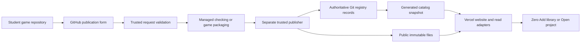

# Zero GitHub sharing adoption plan

Status: adoption design, 2026-10-12. Target: 30–150 students across a few classes.
Owner direction: replace existing code wholesale where useful; no legacy code,
catalog, namespace, route or client compatibility requirement.

Adopt student-owned GitHub repositories, managed checking, public immutable
artifacts and a generated catalog for sharing games and reusable libraries.
Keep Vercel for the website and Maven for dependencies. The new contribution
flow requires no Neon database. Existing Hub deployments and artifacts are
development experiments, not compatibility requirements for the replacement.
Retire unused infrastructure after the new flow and recovery are proven.

Students start with one game repository. They can share the whole game or extract
classes into library folders inside that same repository. Neither action requires
another repository. Passing supported libraries publish automatically; teachers
do not become the routine acceptance queue. Sharing, grading through Pika and
recommendation by a teacher remain separate activities.

## Scope and authority

This plan authorizes no deployment, push, resource provisioning, credential change,
new public release or infrastructure deletion. Those actions retain their existing
authorization requirements. The owner explicitly permits wholesale local code
replacement; use that authority to remove unnecessary modules instead of adding
compatibility layers. Existing candidate tooling need not shape the new design.
Coordinate active writers and preserve unrelated funding/private work.

The existing generic checker acceptance hold remains in force. Moving execution
to GitHub is an architectural proposal, not acceptance of the checker or permission
to repeat a rejected review. Any reused boundary carries its unresolved gate;
any changed executor needs its applicable acceptance before public execution.
See [current state](../.ai/CURRENT.md) and
[existing hosting constraints](ZEROHUB-HOSTING.md).

This becomes the adoption roadmap for the proposed GitHub flow. Existing Hub
plans describe the previous implementation and will be superseded together.
Do not maintain two adoption roadmaps or activate two contribution systems.

## Product decisions

| Decision | Adoption direction |
| --- | --- |
| Student source | Existing public GitHub game repository; optional library folders |
| Shared game | Versioned complete editable project opened separately |
| Shared library | Versioned JAR consumed through ordinary Maven |
| Student controls | Run App, Check library, Share game, Share library, Add, Update and Revert |
| Publication intake | GitHub forms in the canonical Zero repository |
| Authentication | GitHub identifies request authors; no new website account/session system |
| Checking | Trusted platform workflow on managed CI; student workflows are not publication authority |
| Artifact storage | Public Vercel Blob as the initial proposed host, verified before selection |
| Catalog | Generated from authoritative Git records; no database on the read path |
| Website | Existing Vercel project and ZeroHub entry point |
| Approval | Automatic technical publication; optional teacher recommendations and later curation |
| Build tools | Existing pinned Maven wrapper, Java and JavaFX baseline |

The initial source policy supports public repositories owned by the requesting
student's personal GitHub account. Private repositories, organizational ownership,
teams and delegated publishing are later features. This restriction avoids
repository access grants during the pilot. Attribution follows verified numeric
GitHub identities; a pasted owner name is not proof of ownership.

Do not introduce floating versions, another resolver, a new component base class,
a mandatory Gradle migration, per-student servers, AI acceptance, native executable
game builds or a Nexus/Artifactory installation in this adoption.

## Student workflows

### Build and share a game

1. Create an ordinary Zero game and connect the student's own GitHub repository.
2. Develop, Run App and upload source through the existing reviewed Git workflow.
3. Choose Share game. Zero gathers a title, description, controls, screenshot,
   license, project folder and version. It previews the exact committed source.
4. Open a prefilled GitHub publication form. The student signs in through GitHub
   and submits it; no registry token is needed. A request alone does not upload
   uncommitted files or make them part of a release.
5. Automation verifies identity, source and packaging requirements, creates the
   immutable project ZIP, and reports a gallery link or specific corrections.
6. Changes produce another game version. The original version remains available
   unless explicitly withdrawn by the maintainer.

Save the sharing metadata in zero-game.json so later Share actions reuse the
title, controls, screenshot and license. Prefill the request from committed
metadata and the selected commit; students ordinarily change source and version,
not re-enter the same information. Changing local files after the selected commit
does not change that publication request.

A game entry means that a source snapshot satisfies the disclosed sharing checks.
It does not promise gameplay quality, portable native installation or safety of
executing arbitrary Java. The first game policy validates and packages source;
it does not run the game automatically on the service. Optional build/runtime
evidence is a separately accepted policy, clearly labeled by platform.

### Open another student's game

1. Browse the game gallery and inspect its screenshot, controls, source and author.
2. Choose Open project and select a new destination folder.
3. Zero downloads the listed exact ZIP, verifies size/hash and extracts it safely.
4. Open the project through ordinary VS Code workspace trust, then choose Run App.
5. Make changes locally. Connecting a new personal repository is a separate action.

Never overwrite an existing project, configure the original author's remote,
push changes or run downloaded Java automatically. Preserve original attribution
and applicable licenses. The opened project includes pinned wrapper/configuration,
required source and assets, and exact external library dependencies.

### Extract and publish a reusable library

1. Choose Share library while working in the game. Select the related classes and
   their necessary helper classes; the student decides which rules are reusable.
2. Zero resolves the existing repository's stable numeric GitHub ID and combines
   it with the chosen library name to generate its identity and namespace. No
   separate registration request, reservation server or new repository is needed.
3. Place the library under libraries/<name>/ inside the same repository. Preview
   moves, package/import changes and game build changes before applying them.
4. Run the game using the editable local library. Choose Check library to compile
   it independently and run its behavior checks/examples against its actual JAR.
5. Upload the source normally. Share library opens a publication form bound to
   this repository, committed folder and requested exact version.
6. Trusted CI checks the snapshot. A separate publisher lists the library when
   checks pass, or returns useful failures. Correct an unpublished version in the
   same folder and submit the new committed revision.
7. A published version cannot be replaced. Fixes get a new version; consumers
   retain their installed pins until they choose an update.

Keep library identity, prose settings and preview selection in zero-library.json
and the referenced files. Reuse them when sharing another version and prefill the
GitHub form. Students never copy a commit hash or numeric repository ID by hand
in the normal Zero flow. Show the exact revision/version for confirmation.

An existing connected public repository is required to derive the identity. If a
student has not connected one, guide them through the ordinary game-repository
flow first. Permit local experimentation before sharing, but preview any package
changes when converting that draft into an identified library.

### Use a published library

Keep Browse → Add library → Apply → import/use → Run App. Maven resolves the
dependency. Attach sources, preserve undoable dependency edits, exact versions,
independent update histories and Revert. Add and Update never alter student Java
source or silently substitute a different available release.

Release the replacement website and kit as one tested product experience. Keep
manual Maven instructions as an escape hatch, not an old-client compatibility
project. Browsing a website card does not itself install a dependency.

## Repository and build layout

Keep one obvious root game entry point and ordinary Maven project. Use the
standard src/main/java layout and library subprojects; the extension generates
the build integration, so students do not configure a Maven reactor themselves.

```text
student-game/
  zero.json
  pom.xml
  mvnw, mvnw.cmd, .mvn/
  src/main/java/Main.java
  src/main/java/game/...
  src/main/resources/...
  zero-game.json
  libraries/health-bar/
    zero-library.json
    pom.xml
    src/main/java/zero/contrib/r12345/health_bar/...
    src/test/java/...
    examples/first/...
    examples/second/...
    README.md
    CHANGELOG.md
    LICENSE
    preview.png
```

Use a small authored descriptor for title, description, version, kind and examples.
Derive class inventory, public signatures, coordinates, hashes and release records
from trusted tooling. Students should not synchronize duplicate API lists across
Java, JSON and Markdown. Keep authored usage prose in README.md.

Use an ordinary pinned Maven source-root plugin for local library development
and ordinary independent library POMs for Check library and publication.
Zero recognizes only its narrowly generated authoring configuration. Students
need no global Maven, Node, Python, Docker or publication CLI.

Each library has a visible Develop local library / Use published version mode:

- Local mode compiles the selected library source roots and excludes that
  library's binary dependency. Check library builds its own JAR separately.
- Published mode excludes those source roots and uses the exact Maven pin.
- Switching previews POM changes, preserves editable source, and never falls back
  to local classes when a published artifact is missing.

Extraction is recoverable: move rather than duplicate selected source, include
needed private helpers, update imports and prove the game still compiles/runs.
Cancel and partial failure preserve the original project or a recoverable change
set. Do not automatically move gameplay state/rules merely because a class uses it.

A shared game ZIP records the chosen modes. Local library mode includes the
library source and standard build configuration, so another student can edit it.
Published mode uses retained exact library pins. Packaging does not silently
rewrite the game to a different mode or require prior library publication.

Replace current POM/identity assumptions where useful. The new editor must recognize
its generated authoring configuration and scan all selected source roots for
duplicate classes. Arbitrary Maven projects retain a manual path rather than
weakening guards indiscriminately. Do not add a compatibility parser for old
ui-specific manifests.

## Library kinds and checks

Support two explicit kinds in the new policy: JavaFX widgets expose Node view();
ordinary game/data helpers expose their own documented Java API. Helpers require
no fake view, registration system or automatic update lifecycle. Allow private
helper classes and bounded resources within the library namespace.

Start with the existing Java 17 / JavaFX 21.0.12 baseline and a fixed dependency
allowlist. Additional third-party dependencies and dependencies between contributed
libraries are a later policy change; Maven remains capable of them. The catalog
must say which kinds/dependencies the pilot supports.

Check library runs locally without database/web services. It builds the library,
checks public API/source boundaries, runs student assertions through a maintained
JavaFX harness and compiles/runs finite consumers using the built JAR. Local checks
provide development feedback; hosted checks establish publication evidence.

Keep two-consumer evidence for publication, but scaffold it and explain its
purpose. If novice trials show it blocks basic sharing, deliberately revise the
publication policy instead of silently reporting unsupported evidence. Optional
PNG preview can use a generated placeholder; a screenshot is not API correctness.

Compatibility checks compare exported API against the preceding release.
Patch numbering alone does not prove behavior compatibility. Record tested
platforms and disclose the actual scope of checks.

## Database free publication architecture



### Authoritative records

Store small authoritative records on a dedicated registry branch in the existing
Zero repository. This is a branch for data, not another student repository or a
new application server. Keep platform source reviews separate from automated
registry writes. Binaries, generated catalogs and compiler output stay out of Git.

Proposed records: registry/items.json for established ownership/source bindings;
registry/requests/<fingerprint>.json for frozen requests;
registry/attempts/<fingerprint>/<attempt>.json for bounded operational summaries;
registry/releases/<kind>/<id>/<version>.json for immutable releases; and
registry/availability/ for public availability events. Generate website JSON from
these records rather than independently editing two catalogs.

Derive identities without allocation: a library ID is lib-r<repositoryId>-<slug>,
Maven group is ca.codepet.zero.contrib.r<repositoryId>, artifact is <slug>, and
Java namespace is zero.contrib.r<repositoryId>.<packageSlug>. A game uses
game-r<repositoryId>-<slug>. Require lowercase ASCII kebab-case slugs; replace
hyphens with underscores for packageSlug, so distinct accepted slugs do not
collapse into the same Java package. Zero generates these values.

For example repository 12345 and health-bar produce lib-r12345-health-bar,
ca.codepet.zero.contrib.r12345:health-bar:0.1.0 and
zero.contrib.r12345.health_bar. Java packages and artifact IDs remain stable when
the GitHub user or repository is renamed. Published slugs become permanent IDs;
changing a display title does not change the slug.

The first accepted publication establishes kind, numeric GitHub contributor ID,
numeric repository ID, slug and normalized source folder. The publisher recomputes
identity from verified repository metadata, not supplied descriptor authority.
No ui sequence, reservation state or legacy ID conversion is required.

Ownership changes after repository transfer, collaborator publishing, source-path
relocation or account changes require a deliberate migration process. Renaming an
account/repository does not rename Java packages or Maven coordinates.

### GitHub requests

Game and library publication forms live in Zero's official GitHub repository.
Share controls open these forms; students supply no platform workflow or token.
GitHub issue events provide an authenticated actor and durable request channel.
The platform resolves repository metadata itself and verifies the personal owner.

Freeze a full commit SHA, source folder, descriptor/source digest, version,
requester/repository numeric IDs and policy revision before checking. A tag may be
convenient input but must resolve to a full commit; a moving branch/tag is never
publication authority. Normalize bounded paths and disallow traversal/symlinks.

Issue edits create a new request fingerprint; they cannot mutate an in-flight
snapshot. Repeat requests recover the prior result. Reports distinguish source
failures from infrastructure failures, provide file diagnostics where possible,
and preserve request-to-release links. GitHub forms/results are public during the
pilot; do not carry over private legacy reports or operator reasons.

### Managed checking and publication

Use a fixed trusted workflow/code revision from Zero, not a submitted workflow,
POM hook or claimed student CI result. Source retrieval and identity verification
occur outside candidate execution. Candidate Java has no publication credentials,
platform checkout, registry-write permission or reusable privileged cache.

Reuse accepted fixed build/API/behavior checks where applicable. The managed
executor needs the outstanding acceptance and actual Linux runner proof before
activation. GitHub supplies the machine; it does not establish candidate isolation
or make a submitted receipt trustworthy.

Publication is a separate environment/job that does not execute candidate code.
It validates fixed workflow provenance, frozen request/source/policy identity and
artifact hashes. Contributors cannot supply another author's identity, a trusted
verdict or an arbitrary destination URL. Students need no rights to the central
artifact store. Publisher credentials stay outside checking.

Jobs have explicit deadlines, bounded output and controlled concurrency. Official
issues remain the durable inbox. A bounded dispatcher/reconciler finds requests
not represented by a terminal attempt/release record. Manual rerun and finite
infrastructure retries recover interrupted jobs without duplicate publication.

GitHub concurrency is an execution control, not our authoritative request ledger.
Its default pending queue replaces earlier pending runs; queue:max currently
allows up to 100 pending runs but can still cancel overflow. Never lose a request
because its initial event run was dropped. Begin with manual reconciliation;
activate a bounded recurring reconciliation workflow only as part of an explicitly
authorized operating rollout.

### Immutable publication and catalog updates

1. Produce bounded JAR/source/POM/checksum/preview files or a deterministic game ZIP.
2. Upload to temporary attempt/digest-addressed Blob keys with overwrite disabled,
   then download and verify every staged object's size and digest.
3. Revalidate current ownership, source/policy bindings, availability and version.
4. Atomically commit the accepted release record against the expected registry
   branch SHA, including hashes and intended final paths. This commits the version
   to this source permanently, initially with delivery pending.
5. Finalize files to standard Maven paths or games/<id>/<version>/project.zip,
   with overwrite disabled. Verify public size/hash/GET/HEAD/checksum behavior.
   An identical existing file is reusable; any mismatch pauses publication.
6. Append delivery-ready state to the registry, then generate an immutable catalog
   snapshot. Serialize catalog pointer advancement with publication so an older
   build cannot replace a newer snapshot.
7. Verify public reads before reporting that the release is discoverable. Recover
   any interrupted finalization from its accepted release record and staged bytes.
   Accepted versions awaiting delivery cannot be replaced with corrected source;
   report publication accepted, delivery pending rather than a student test failure.
8. Remove temporary copies only after final verification and the recovery retention
   window. Do not retain a permanent duplicate of every Maven artifact.

Staging before committing the version prevents an interrupted attempt from
poisoning an unaccepted standard Maven path. Committing before final path creation
means competing sources cannot both finalize the same version. Once accepted,
recovery must finish the original bytes; source changes require a new version.
Failed checks before acceptance still permit correction of an unpublished version.

Serialize registry commits and use compare-and-swap/revalidation on conflicts.
Matching existing releases succeed idempotently; changed source for a published
version fails. Never use force-push as a retry mechanism. Concurrent catalog builders
must not move the current snapshot backward.

Keep the distinction between release immutability and metadata correction. Public
display/availability changes append records; original source/artifact/check evidence
remains unchanged. Failed unpublished source may be corrected. Unlisted orphan
uploads can be reclaimed after an operator-defined recovery window.

Catalog updates should not require a full website deployment for every student
release. Vercel reads a generated public JSON snapshot through a bounded cached
adapter; it never queries Neon in the new mode. Git records remain authoritative,
and public Blob stores catalog files as well as artifacts. Validate every snapshot,
retain a last-known-good snapshot and fail closed for unknown releases.

Design new clients for public object delivery from the outset. Library manifests
carry verified file hashes and URLs on the one configured Blob store origin.
Zero verifies directly fetched bytes; Maven uses a public standard-layout path
on that store. Game ZIPs use direct public Blob delivery too. Students supply no
artifact URL or alternate Maven repository through contribution metadata.

Use explicit paths such as maven/<group path>/<artifact>/<version>/<filename>,
with overwrite disabled, plus digest-addressed catalog/snapshot objects. CI
verifies public Maven resolution and GET/HEAD/checksum behavior before accepting
the store. A stable optional Maven subdomain can map to the chosen store only if
its static mapping works without a JavaScript byte proxy or database. It is not
required for the first pilot. Do not retain old same-origin artifact adapters or
double delivery merely to accommodate undeployed clients.

### Game snapshot contract

Create ZIPs from the exact committed source with sorted paths, normalized timestamps,
preserved wrapper executable permissions and pinned packaging tooling. Record the
ZIP digest and source identity; retain the ZIP independently of the student's repo.
GitHub-generated archive URLs alone do not provide our durable byte guarantee.

Include required game source, local library source when selected, assets, license,
wrapper, zero.json and supported editor configuration. Exclude .git/history,
credentials/private config, dependency caches, target/build output and unrelated
folders. Preview the included files before requesting publication. Use a bounded
file policy and verify archive extraction paths, permissions and resource totals.

Shared game media needs license/attribution compatible with redistribution; do
not assume a game's assets inherit the library's MIT license. The first policy
accepts Zero-compatible runnable source projects. Executables, arbitrary installer
scripts and automatic execution on opening are outside the pilot.

## Teacher and maintainer responsibilities

| Role | Regular work | Exceptions |
| --- | --- | --- |
| Student author | Develop, local checks, reviewed Git upload, publication request, corrections | Source or permission problems explained by the request report |
| Student consumer | Browse, Add/Open, run, explicit updates and own edits | Exact missing/withdrawn versions need recovery guidance |
| Teacher | Teach extraction/reuse/testing; assess separate Pika submissions; recommend examples | No routine package approval or CI administration during class |
| Maintainer | Maintain template/check policy, trusted workflows, publishing/storage, documentation and alerts | Ownership disputes, content curation, failed infrastructure and restore |

Automatically checked is not teacher endorsement. Highlighting a library/game
does not alter installed pins. No lifetime contributor/library-count cap is added;
temporary rate/queue limits and shared capacity safeguards remain. Operate against
the approved [curation policy](ZEROHUB-POLICY.md), adapted deliberately for games.

Public curation records expose only necessary availability status. Private operator
notes, abuse reports and legacy withdrawal reasons stay in private operator storage,
not a public registry branch. Removal cannot revoke source/artifacts already copied
by students or retained in Maven caches. Verify cache removal behavior separately.

## Cost and scale controls

The prototype uses fixtures/local files before any paid provisioning. Vercel Blob
is proposed because Vercel is already in use and public reads need no credentials.
Before selection, verify no-overwrite retry behavior, GitHub publisher credentials,
region/rates, direct public delivery, backups and cached removal against the real
store. A failing storage proof is a decision point, not reason to weaken integrity.

Standard GitHub runners for public repositories currently have no minute charge.
Provider concurrency/usage rules still apply. Vercel Pro currently starts at
US$20/month; Hobby eligibility is personal/non-commercial, so check eligibility
instead of inferring it from free classroom downloads. Blob bills storage,
operations and delivery; website/catalog traffic has separate delivery costs.
These are provider facts, not a quote for the complete system.

Measure requests, attempts, queue delay, check duration, catalog propagation,
artifact bytes, transfer, infrastructure failures and operator time. Illustrative
workload: 150 students × 5 versions × 1 MB = 750 MB of artifacts before backups/source;
150 checks × 2 minutes = 5 hours on one checker. Actual averages must come from the pilot.

Phase 1 records proposed source/game/artifact limits, job timeouts, concurrent jobs,
temporary rate budgets, shared storage thresholds and alert owners. Test a burst of
20 and a full 150-request simulation for eventual completion with no lost requests.
Do not promise low queue delay from student count or extrapolate tiny Starter UI
files to a term of contributions.

Keep immutable artifacts plus catalog/registry exports in an independent backup.
Avoid retaining artifact bytes twice in request/results and object storage. Reports
store hashes/provenance, not redundant binary copies. Preserve minimal permanent
release evidence while applying explicit retention to failed-attempt logs and
unlisted temporary objects. A storage cap must return a useful platform-unavailable
result rather than silently dropping requests or deleting valuable state.

## Clean replacement and recovery

1. Save a recoverable source snapshot and inventory the existing external resources
   and any useful private data. Existing published test assets can remain untouched
   externally; they do not need new-code compatibility routes or catalog entries.
2. Build the replacement against fresh schemas, identities and generated catalogs.
   Do not import Neon identities, sessions, reservations, requests or ui IDs.
3. Reuse maintained Java source and teaching examples where useful, then publish
   them under the new identities through the new trusted pipeline. Never overwrite
   old externally published asset bytes in place.
4. Remove the old database/OAuth/upload/pipeline runtime, SQL migrations, manifests
   and tests that exist only for retired behavior. Preserve useful checks as
   behavior tests for the replacement rather than carrying an adapter layer.
5. Verify website/client/publishing from a clean configuration with no Neon
   variables, PostgreSQL dependency or old API routes. Test cold object reads,
   clean Maven cache, game downloads, outages and withdrawal/restoration.
6. Publish the newly tested kit and website only under explicit rollout authority.
   Keep publication off until the actual managed execution/storage proofs pass.
7. Recovery uses the new registry/object backups and last-known-good catalog. If
   checking fails, pause publication while retained downloads continue. If website
   code regresses, restore the last accepted new deployment/catalog. Do not roll
   active contributions back to the old Neon service.
8. Once the replacement and restore drill pass, retire Neon and unused credentials
   with separate external-action authorization. There is no required 30-day legacy
   compatibility window. Preserve a private export only if the inventory identifies
   valuable data; verify recovery before any destructive deletion.

Availability/withdrawal events created after adoption must survive rollback. Emergency
publication pause is separate from public download availability; known retained
releases should remain readable during a checking outage.

## Implementation phases

| Phase | Deliverable and ownership | Exit evidence |
| --- | --- | --- |
| 0 Establish baseline | Coordinator records useful source, active writers, holds and external resource inventory | Recoverable source; one current adoption backlog; no legacy compatibility scope |
| 1 Fix contracts | Coordinator owns identity/intake/game/library/registry/storage contracts with focused read-only input | Concrete schemas, public visibility, capacity proposals, Blob proof design and acceptance route recorded |
| 2 Prove local authoring | One extension/build writer owns extraction, nested library discovery, mode switch, local Check and shared harness | One class, related classes/private helper and ordinary helper extracted; original game works; cancellation/recovery; no second repo |
| 3 Prove database-free records | One registry/pipeline writer owns deterministic identity, issue fixtures, frozen requests, reconciliation, idempotent publication and catalog generator | Rename/transfer/unauthorized requests, edited requests, failed/corrected/repeated submissions, races/crash recovery; no lost requests |
| 4 Prove managed execution and storage | Executor and publisher writers have separate components/contracts | Applicable held acceptance resolved; real managed runner and approved public store proof; candidate has no publisher credential; failed checks never publish |
| 5 Integrate consumption | One website writer and one extension writer implement new gallery/catalog and direct public install/open actions | New library Add/Update/Revert; exact game ZIP opens separately; direct Maven/object delivery; no automatic run or remote mutation |
| 6 Run novice pilot | Coordinator/teacher recruit 3–5 students; use published compatible pilot tooling only after required approval | One game and extracted library shared, corrected, installed/opened by another student; usability/cost/operator evidence |
| 7 Release replacement | Coordinator owns reviewed source/release rollout | New registry/object backup/restore, no DB dependency, actual public flow and recovery drill pass |
| 8 Retire old service | Coordinator/owner controls authorized deletion and credential cleanup | Useful data preserved; new releases/availability retained; Neon removed only with explicit authorization; docs/recovery complete |

Phases 2 and 3 can proceed independently after shared contracts. Phase 4 cannot
activate before execution acceptance. Phase 5 can use inert fixtures while that
gate remains unresolved. Phase 6 requires real approved execution/publication for
library claims; a mocked browser flow is not a successful adoption pilot.

Use the smallest effective team, one writer per component and isolated working
state for independent writers. Review fixed consequential execution/publication
changes under the existing repository workflow; avoid redundant review waves.
Record source revision, checks and actual limits at each phase exit. Old candidate
source/layout does not constrain the rewrite; new releases have their own version
and receipts, without overwriting previously published asset bytes.

## Acceptance and classroom pilot

Technical acceptance covers identity/source binding, immutable versions, request
reconciliation, separated publication, path/source shadowing, recovery from object
upload/Git/catalog failures and behavior with GitHub/storage outages. Test stored
bytes and real Maven consumers; manifests or HTTP 200 alone are insufficient.

Game tests cover deterministic ZIPs, extraction traversal/symlink/bomb guards,
wrapper permissions, included assets, exact dependency pins, new destination and
no inherited Git remote. Library tests cover local/binary exclusivity, helper
sources, actual JAR origins, source attachment and useful file diagnostics.

Test Apple Silicon Mac and an actual Windows machine using existing supported
kit/toolchain paths. Record managed checker platform separately. Existing Mac or
Mono/backend checks do not establish clean-machine Windows or novice usability.

Proposed pilot targets, to validate rather than claim as observed:

- At least 4 of 5 students Add/use/Run an existing library within 5 minutes without
  manual POM/JSON editing.
- At least 4 of 5 extract a prepared component and pass local Check within 15 minutes,
  after the component itself has been written.
- At least 4 of 5 submit a publication request, correct one intentional failure and
  recover the result without teacher infrastructure intervention. Measure active
  work separately from CI waiting.
- At least 4 of 5 open another student's game in a separate folder and run it within
  5 minutes after required tooling is installed.
- Twenty-request burst and a 150-request simulation reach a terminal report for every
  eligible request; publish conflicts do not overwrite releases.
- No routine teacher approval is needed. Infrastructure incident count, maintainer
  minutes and actual storage/compute/transfer are included in the adoption decision.

If publication forms dominate confusion, compare one simpler intake revision
before building website accounts. If required files/tests dominate confusion,
improve scaffolding and local checks. If maintenance remains high, reconsider
the publishing promise; do not add another GUI to disguise operational problems.

## Files and documentation affected

| Area | Expected work |
| --- | --- |
| extension/src/library-files.js | Nested library identification and Share/Check preparation |
| extension/src/hub-components.js and project-pom.js | Replace ui-only assumptions with new identity/catalog contract, author mode and duplicate guards |
| extension/src/hub-actions.js and project/run helpers | Share/Open controls, diagnostics, recovery and minimal sidebar behavior |
| hub/development-files.mjs and maintained libraries | Ordinary library scaffold, small descriptor and local test harness |
| hub/checker policy/executor | Versioned widget/helper rules and accepted managed execution adapter |
| New trusted registry/publishing scripts and GitHub forms/workflows | Deterministic identities, frozen requests, ownership, CAS, reports, durable reconciliation and operator controls |
| website Hub components and lib adapters | New games/libraries interface, generated catalog and direct public artifact delivery |
| hub/sql, OAuth/upload/pipeline/runtime modules | Remove obsolete runtime/schema/tests; keep useful source only in recoverable history |
| PRODUCT, ARCHITECTURE, COMPONENTS, ZEROHUB plans, tutorials and DEVELOPMENT | Update final behavior and superseded instructions together at rollout |
| EVIDENCE, VERIFICATION and CURRENT | Coordinator records actual accepted phase state; preserve other active writers |

New npm/Maven/Action/tooling dependencies are pinned and locked. Generated
catalogs/artifacts and private receipts stay out of Git. Do not generate tests
that merely repeat implementation; use the failure/recovery scenarios above.

## Next deliverable

Begin with phase 1 contracts and a local phase 2 vertical slice: an existing game,
one extracted HealthBar-style library plus a private helper, local checks and
switching between editable source and its exact published fixture. Include a
game ZIP opened in a separate folder. This proves the one-repository learning
workflow before spending on integrations or removing Neon. No legacy routes,
schema migration or catalog import belongs in this vertical slice.

The adoption is complete only when actual students can share a game and a library,
another student can run/use them, automatic publication and operator recovery work,
newly published versions remain accessible, and the replacement operates without Neon.

## Reference basis

- [GitHub standard runners](https://docs.github.com/en/actions/reference/runners/github-hosted-runners)
  support managed execution and currently free standard public-repository jobs.
- [GitHub issue events](https://docs.github.com/en/actions/reference/workflows-and-actions/events-that-trigger-workflows#issues)
  support trusted request ingestion; submitted text is still untrusted data.
- [GitHub concurrency](https://docs.github.com/en/actions/how-tos/write-workflows/choose-when-workflows-run/control-workflow-concurrency)
  describes bounded pending queues; durable reconciliation is still required.
- [GitHub workflow security](https://docs.github.com/en/actions/reference/security/secure-use)
  describes risks around untrusted code, privileged workflows and artifacts.
- [Vercel Blob SDK](https://vercel.com/docs/vercel-blob/using-blob-sdk)
  describes public files, names and overwrite options; storage proof must verify
  the exact pinned SDK behavior used by this publisher.
- [Vercel Blob pricing](https://vercel.com/docs/vercel-blob/usage-and-pricing),
  [Vercel pricing](https://vercel.com/pricing) and
  [Hobby eligibility](https://vercel.com/docs/plans/hobby) inform the cost review.

Provider facts were checked 2026-10-12; verify prices, limits and credentials again
before provisioning. This architecture replaces custom session/upload/queue
services with GitHub records and managed jobs; it does not eliminate release,
storage, compatibility, execution or maintainer responsibility.

## Planning receipt

Coordinator authored this plan from current source/contracts and the owner's
accepted one-repository games/library direction and clean-replacement permission.
Two bounded GPT-6.1 Sol / medium
read-only assignments supplied student/build and publication/migration inputs;
coordinator verified POM/shadow constraints, artifact duplication and provider
queue/overwrite behavior. No candidate isolation acceptance was attempted.
Weekly allowance 50% remaining is account-wide; attributable tokens/time and effective
worker model telemetry are unknown. A fresh GPT-6.1 Sol / medium plan check found
two consistency gaps: storage addressing and metadata reuse. The final plan makes
both explicit, including recoverable standard-path finalization after Git acceptance.
This receipt records planning, not implementation or checker acceptance.
