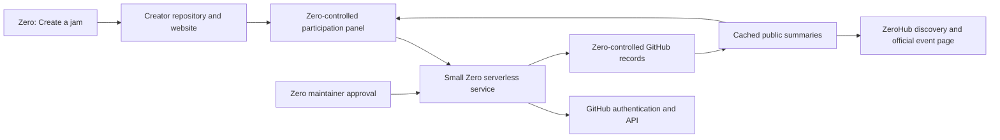

# ZeroJams architecture and user flow

Status: protected two-account preview activated; production remains hidden,
2026-10-25. Both `stewchan` (creator, no maintainer role) and `armorup` (approver)
completed live GitHub sign-in. The Game/App lifecycle passed with24 durable
operations and zero registry-triggered Vercel builds. Reviewed reconciliation
source `d5a60666` is deployed in preview revision `70de6ba8`; all11 exact-head CI
checks pass.111 jam/264 website tests, independent review and Chrome loopback
regression pass: lost Join reply → recover → Leave → new Join, with3 commits and
final registration joined. Recovery stays available after reload and distinguishes
historical confirmation from new intent, including another-device Leave.

The local durable-settlement candidate adds explicit close/recover outcomes,
atomic branch transactions and a guarded registry migration.154 jam/272 website
tests, typecheck/build and actual Chrome lost-close/reload recovery pass locally.
Two independent reviews and the targeted correction review pass. Three P2s
were fixed in one batch. Protected-preview delivery and guarded migration are next. Cross-browser,
school-network and provider-cost acceptance remain open. No production rollout
or main merge is authorized.

The pilot is restricted to the fixed Preview project, branch, origin and invited
numeric identities. Production always returns 404 for jam pages, panels, APIs and
template downloads, even with activation flags. ZeroHub hides its production link;
editor shortcuts remain deferred. Existing sharing and Pika submission stay
separate. No main merge or production rollout is part of pilot activation. See
[the pilot operator packet](ZEROJAMS-PILOT.md) for configuration, live results and
remaining acceptance. The preparation snapshots below record earlier states;
they do not supersede this current authorization and activation record.

## Goal and agreed decisions

Any user can create a jam website in their own repository, submit the event for
Zero maintainer approval, and let others join and submit projects through that
page. Zero controls official admission, participation rules and moderation while
creators retain their source, branding and hosting.

The agreed direction is:

- **ZeroJams** is the umbrella, with **Game Jam** and **App Jam** event types.
- Anyone can propose an event; a teacher affiliation is not required.
- Every Game Jam and App Jam requires GitHub participation: students sign in on
  Zero to join and submit their own public GitHub repository at an exact commit.
  This is a platform requirement, independent of creator eligibility wording.
  Browsing and preparing/downloading a site remain available before sign-in.
- A Zero maintainer approves the event before official participation opens.
- Creators host their websites, with GitHub Pages as the default template path.
- Zero maintains the complete canonical website template in this repository. Each
  creator gets an independent, versioned copy in their own repository, including
  HTML/CSS/JavaScript, example content/assets, event configuration, publishing
  workflow and the standard participation-panel integration.
- Template updates apply to future copies; existing sites adopt updates explicitly.
  Zero stores official event records, not a mirrored copy of every creator site.
- Zero provides a creation shortcut and a shared participation experience.
- A small GitHub-backed service handles official actions, without a new dedicated
  database or an always-running application server.
- Participant projects and playable/demo builds remain creator-hosted too.

Success means a non-maintainer creates an approved jam, participants join and
submit through its page, and the event finishes with a preserved official
showcase. Nobody needs access to Zero infrastructure to organize an event.

## Event types and initial scope

| Type | Outcome | Type-specific presentation |
| --- | --- | --- |
| Game Jam | A playable game | Play link, gameplay instructions, game-oriented prompts |
| App Jam | A useful app, tool, simulation or interactive project | Open app/demo link, usage instructions, problem and audience prompts |

Both types share one event model, approval process and participation service.
The type selects template copy, submission prompts and example criteria; it does
not create a second platform. Competitive versus showcase-only is a separate
event choice. Automated judging is outside the first release.

Proposed MVP defaults, to validate during implementation: public events and
records, individual participation, one active project entry per
account per jam, and Zero-created games/apps. Teams, private events, other
toolchains, prizes, chat, email notifications and ranked voting are later work.
These defaults are not additional owner decisions.

## Ownership and authority

| Actor | Owns or may do | Authority boundary |
| --- | --- | --- |
| Creator/organizer | Website repository, design, assets, hosting, proposed rules and updates | Cannot approve their own event or rewrite official participation records |
| Zero maintainer | Approval, official configuration, reports, suspension and cancellation | Does not take ownership of or silently edit the creator's repository |
| Participant | Account participation and their project repository/demo | May change only their own registration/entry within the event rules |
| Zero service | Authenticate, validate, record and serve official results | Acts only within reviewed GitHub permissions and accepted event configuration |

Zero can remove discovery, suspend official actions, withdraw entries, or cancel
the official event. It cannot take down a creator's independently hosted site.
Repository transfer does not automatically transfer organizer authority; stable
numeric GitHub account/repository IDs bind approved ownership.

## Architecture

The creator's page is ordinary static HTML/CSS/JavaScript. Zero does not build,
execute or mirror arbitrary creator website code. A template includes a small
event manifest, proposed as `zero-jam.json`, and a standard participation panel
configured with the stable event ID after acceptance.

ZeroHub provides discovery and a permanent official summary, proposed at
`/hub/jams/<id>`, alongside a creator preparation area, proposed at
`/hub/jams/create`. Display names and slugs may change without changing event ID.
These routes and the editor shortcut are proposed, not implemented.

The shared service belongs with the existing website serverless routes. Reuse
the existing GitHub sign-in/session patterns after inspecting current contracts;
do not assume existing GitHub permissions already permit jam writes. GitHub
holds durable official records. Cached summaries provide cheap public reads.
There is still backend execution, provider dependency and maintenance, even
without a dedicated database or provisioned server.

## Creator preparation and review flow

### Guided preparation follow-up — 2026-10-25

Owner requested a local guided **details → actual website preview → customized
download** flow. Keep the production hold and existing published-site approval
flow. No GitHub sign-in is needed to prepare/download; no remote repository or
hosting changes occur. The full editable website stays in the creator's copy.

Delivered locally at reviewed source `35241dde` (base `25acd272`). The guided
form, actual canonical-template preview, customized ZIP and separate source
proposal form are implemented. No new PR or production activation was performed.
Focused62tests,240website tests, typecheck/build and Chromium checks pass;
production build remains closed even with the activation flag. Safari/WebKit and
live GitHub hosting/approval are unverified. Evidence: `docs/EVIDENCE.md`.

Implementation contract for this slice:

- Browser-safe `website/lib/jam-draft.mjs` exports `defaultJamDraft(type='game',
  timezone='America/Toronto')`, `JAM_DRAFT_LIMITS`, and `prepareJamDraft(draft)`.
  Result is `{manifest:null|normalizedManifest,errors:{field:message}}`.
  Draft string fields: type,title,summary,theme,rules,eligibility,websiteUrl,
  timezone,registrationOpensAt,startsAt,submissionsCloseAt,registrationClosesAt,
  submissionsOpenAt. Main dates use `datetime-local` minutes in the selected IANA
  timezone. The last two are optional overrides, defaulting to startsAt. Empty
  websiteUrl generates the documented placeholder, to replace after hosting.
  Reject nonexistent/ambiguous daylight-saving times with useful field errors;
  preserve inputs. Shared canonical manifest validation remains authoritative.
- `POST /api/jams/template/preview` accepts `{manifest}` and returns
  `{html,manifest}`. HTML uses the exact canonical template/assets with escaped
  embedded JSON, a restrictive CSP and disabled anchors (CSP alone cannot block
  document navigation). No preview network access. Display it only in a
  titled iframe with sandbox `allow-scripts` (no same-origin/top-navigation).
- `POST /api/jams/template` accepts the same body and returns the complete ZIP
  with exactly the same normalized manifest. Existing GET downloads still work
  locally. Both handlers reject production before reading bodies/templates.
- New `JamPreparation` component owns type/details, validation, preview/edit,
  download/error recovery and next hosting steps. Persist public draft fields
  in sessionStorage only. Keep one primary action per step, associated errors,
  keyboard/focus and320px reflow. Clearly distinguish download from publication.
  `JamCreate` retains its existing source-bound approval form separately below.

Ownership: coordinator writes shared draft/schema/template helpers, HTTP routes,
integration and docs; bounded UI worker owns only JamPreparation.tsx and its CSS.
Verify timezone/DST, HTML injection isolation, preview/ZIP equality, original
downloads, local actual browser flow and production404. One independent review
will cover the final coherent slice after checks. This is implementation work,
not authorization to lift the production hold or change accounts/permissions.

1. **Create a jam.** Choose Game Jam or App Jam from Zero or the web preparation
   page. Both lead to the same workflow. Use a creator-owned public repository
   and template, with an explicit review before repository or hosting changes.
2. **Build and publish the page.** Customize branding, introduction, theme,
   resources and promotional content. Publish through the creator's GitHub
   account. No Zero runtime or credentials are added to their site.
3. **Prepare the proposal.** Supply title, type, description, organizer, repository,
   website URL, theme, rules, eligibility, timezone, registration window, building
   window and submission deadline. Public rules should require no private
   roster, contact or identity information.
4. **Preview.** Show the actual creator page separately from the official event
   summary and participation controls. Check required fields, URL structure,
   schedule consistency and source ownership. No official joining is enabled.
5. **Submit for review.** Bind the request to the authenticated organizer, numeric
   repository ID, exact source commit and normalized proposal revision. An issue
   may provide the public review conversation; its editable body is not the
   authoritative accepted configuration.
6. **Maintainer review.** Approve, request changes or reject with a useful reason.
   Automated checks assist review; they do not replace maintainer approval.
7. **Activate.** Record the accepted configuration and approved website address,
   assign the permanent event ID, publish the ZeroHub summary and enable actions
   when the approved schedule allows. Return the panel embed/link to the creator.
8. **Manage.** Show review feedback, current proposal, accepted revision, live
   status and submitted updates. Keep the previous accepted event operational
   while an update is under review, unless a maintainer suspends it.

The preparation page therefore contains repository/hosting guidance, page and
event previews, readiness errors, Submit for approval, review history and the
accepted event link. Website browsing and discovery need no sign-in.

## Participant flow

1. Open the creator's page or discover the event through ZeroHub. The official
   panel shows the event title, organizer, type, accepted rules, dates and status.
2. Choose **Join jam**. A Zero-controlled popup or top-level page handles GitHub
   sign-in and explicit confirmation of the displayed event and public record.
   Return to the creator page after success; do not expose an issue form.
3. The service checks identity, accepted rules revision, event status and server
   time, then durably records registration. Show Joined only after confirmation.
   A pending/unknown result must not look like successful registration.
4. While submissions are open, choose **Submit project**. Enter the public
   repository, exact commit, title, description, playable/demo URL and type-specific
   instructions. Verify repository ownership/access under the chosen MVP policy.
5. Show a review of the exact entry before accepting it. Record source identity,
   entry revision and service timestamp. A demo URL may change independently and
   is not evidence that its bytes match the frozen source.
6. Before the deadline, allow reviewed replacement submissions and withdrawal.
   Keep revision history; retries must not create another entry. Leave/rejoin
   behavior is explicit: leaving withdraws an active entry, and rejoining does
   not silently restore it.
7. After the deadline, show the accepted gallery and the participant's final
   entry. Moderation remains possible with recorded reasons; ordinary entry edits
   remain closed. Joining a jam does not separately publish a project to ZeroHub
   or submit coursework to Pika.

## Official state and GitHub storage

Use separate contracts for proposals, accepted event revisions, registrations,
entry revisions and moderation actions. Minimum records are:

| Record | Important fields |
| --- | --- |
| Event revision | Stable ID, type, organizer ID, repository ID/commit, website URL, normalized rules, UTC boundaries, display timezone, approver and approval timestamp |
| Registration | Event ID, GitHub numeric user ID, accepted rules revision, joined/left state and timestamps |
| Entry revision | Event ID, participant ID, repository ID, exact commit, title/description, demo URL, received timestamp, previous revision and active/withdrawn status |
| Operation/moderation | Operation ID, actor, target, result/reason, revision and timestamp |

Keep official records in a Zero-controlled repository/branch namespace. Reuse the
existing GitHub registry adapter where appropriate, with a separate versioned
ZeroJams contract. Do not let organizers write the authoritative registry or
silently add jam records to existing game/library schemas. Partition by event;
avoid a single ever-growing JSON file containing all participation history.

Use conditional Git updates with bounded conflict retries. Commit each mutation
and its operation result atomically. Repeated requests carry an idempotency key
bound to authenticated actor, event and payload; after a timeout, looking up the
same operation recovers its result. Concurrent retries cannot produce duplicate
joins or replace a newer entry. The accepted operation's durable timestamp decides
deadline eligibility; delayed retries recover that result rather than extending
the deadline. Conflicting payloads with the same key fail explicitly.

Raw issues, labels, comments and webhooks are intake or notification hints, not
approval authority. A forged label, edited issue body or client-supplied username
must never grant organizer status or change accepted rules. Reconciliation reads
the authoritative records and can repair derived summaries after interruptions.

## Event lifecycle and changes

Keep review status separate from participation phase:

- Review: draft, submitted, changes requested, approved or rejected.
- Moderation: active, suspended or cancelled; retain closure/history separately
  from discovery visibility.
- Participation: upcoming, registration open/closed, building, submissions open/
  closed and completed, derived from accepted schedule and current server time.
  Building and registration may overlap; these are not one rigid linear enum.

Store UTC instants plus the chosen IANA display timezone. Show unambiguous local
dates and timezone labels. Enforce half-open windows: an action is allowed at its
opening instant and refused at or after its closing instant. Validate boundary
ordering and registration/submission eligibility on every write. Scheduled jobs
are not required merely to close buttons or enforce a deadline.

Repository pushes do not update the official configuration. Organizers propose
new revisions; changes to organizer, website destination, dates, eligibility,
rules or submission requirements require maintainer approval. Once users join,
show the material change history and require renewed acknowledgment before the
next applicable action. Do not silently apply stricter rules retroactively.
Deadline extensions and effects on existing entries require explicit review.

Creator-hosted HTML remains mutable. Record the reviewed source commit, but do
not claim Zero freezes the deployed website or endorses every future edit. The
Zero-owned summary/panel is authoritative if website copy disagrees. Cosmetic
website edits may deploy independently; misleading changes can trigger review,
suspension or removal. Preserve the small official summary and entry references
if the creator repository/site disappears; continued availability of external
websites or project assets is not guaranteed.

## Authentication and trust boundaries

- Keep GitHub secrets and participant tokens out of creator HTML, scripts,
  manifests and browser storage controlled by creators. Require neither pasted
  personal access tokens nor participant repository write access for browsing.
- Serve the participation panel from Zero's origin. Treat its parent page and
  all messages from it as untrusted. Allow only explicit approved embed origins
  and exact message schemas; never accept arbitrary return URLs or event actions.
- Use the panel for display/launch and perform authenticated confirmation in a
  Zero top-level page or popup with anti-framing protection. This prevents a
  creator's overlay from silently confirming a sensitive action. Provide a
  full-page fallback for blocked popups, third-party cookies or storage.
- Bind OAuth state, session and CSRF protection to the intended flow. Revalidate
  identity, event authority and rules before each write. CORS is not authorization.
- Grant the GitHub App only the reviewed access needed for official jam records
  and source metadata verification. Review existing shared-App effects before any
  permission or installation change; do not assume unrelated repositories work.
- Render public metadata as text/sanitized content. Bound request sizes, counts,
  fetches and redirects; validate links without executing submissions or fetching
  arbitrary internal URLs. No remote website/game build runs in the service.
- Public participation means GitHub handle, entry and history may be public.
  Explain this before joining. Collect no email, student number or private roster
  in public Git storage. Withdrawal removes current display but is not a promise
  to erase Git history; private participation needs a separate storage design.

## Sustainability and failure behavior

Page builds, assets, traffic and project demos stay with their owners. Zero pays
for its small official summaries, bounded authentication/actions, GitHub requests,
cache/storage and moderation. This is a cost-distribution strategy, not a promise
of zero cost or permanent free provider allowances.

Cache public event/gallery summaries and paginate entries. Do not rebuild the
whole website or dispatch an Actions workflow per join/submission. Use bounded
revalidation and explicit result refresh rather than continuous polling. Protect
writes with per-account/event limits and reviewed provider/platform rate limits.
Cap events and participants during the pilot and make overload visible.

Never report success before durable acceptance. During GitHub failure/rate
limiting, preserve the draft, explain retry status and recover by operation ID.
Do not queue new deadline-sensitive submissions as though they were accepted.
Do not silently switch to local-only state or accept unauthenticated writes.
Cached public browsing can continue with freshness information; write permission
must be checked against authoritative configuration and conditional revision
guards so suspension/deadline changes cannot be bypassed through stale caches.

Measure requests per join/submission, GitHub calls and conflicts, latency,
cache freshness, storage growth, errors and maintainer review time during the
pilot. Set concrete spending/usage limits and a suspension procedure before live
rollout. Revisit storage if measured contention or rate limits justify it; do not
introduce a database speculatively or treat Git as an unlimited transactional DB.

## Execution status — 2026-10-25

User authorized phased local implementation and orchestration. Coordinator goal:
deliver a verified local MVP ready for independent review, with complete creator
website template, preparation/admission, official discovery and participation.
Source publication retains the production hold. The owner subsequently authorized
the narrow controlled pilot described above; general rollout remains held.

Active checkout: `/Users/stew/.codex/worktrees/zerojams/zero`, branch
`codex/zerojams-controlled-pilot`, deployed source `f50942b0`. Primary checkout's unrelated work is preserved.
Canonical template directory: `jam-template/`; shared pure service: `jams/`;
website entry point: `/hub/jams`. Template copying starts with a downloadable
complete ZIP; it must not claim a separate hosted template repository exists.
An editor shortcut is deferred while production is hidden; the local web creation
flow needs no Java project or second account. Automated remote repository creation can follow
only when a pinned public template is actually available and verified.

| Phase | State | Exit evidence |
| --- | --- | --- |
| 1: Contracts, complete template and preparation | Locally delivered | Shared contract, independent website copy, both types, safe preview |
| 2: Creator admission and discovery | Locally delivered | Source-bound proposal, maintainer-only approval, immutable accepted metadata |
| 3: Participation | Locally delivered | Authenticated join/leave, reviewed entry updates/withdrawal, cached gallery |
| 4: Reliability, UI verification and independent review | Locally verified and reviewed | Meaningful failure/security checks, actual local browser proof, clean reviews |
| 5: Live pilot | Two-account Chrome lifecycle verified | Both types prepared/hosted/proposed/approved/participated/submitted/updated/closed; 24 operations and zero registry builds; expansion checks remain |

Worker receipt: source-map (GPT-6.1 Sol/high) completed read-only mapping of
existing auth, CAS, navigation and editor seams; coordinator verified principal
paths. No rework. Effective model, elapsed/token telemetry unknown. Start usage:
97% weekly remaining (account-wide); fresh storage check healthy,241.3GB available.
DeepSeek remains paused through2026-12-31. Engine worker delivered source-bound approval/participation, bounded GitHub
adapters and22passing tests. Template/UI worker delivered the complete independent
site, safe panel and review/participation UI; coordinator added helper symlink
protection and integrated auth/runtime. Small pre-review corrections addressed
optional instructions, deployment file lookup, actor-specific views, durable
retry keys, review inbox and individual entry moderation. Worker elapsed time and
tokens remain unknown; no savings claim. Verification:45focused jam tests,
216website tests,1141root tests passed with3pre-existing runtime skips; root check
and website type/build pass. Final review/check evidence follows in EVIDENCE.md.

Review ledger (high risk: new event authority and server writer credential): two
independent GPT-6.1 Sol/high reviewers, one security/correctness and one architecture/
compatibility. Budget: max7launches, one initial full-diff wave,4targeted waves,
4remediation batches, one final integration wave,60minutes session/30minutes worker.
Initial wave completed at831d7b18: security1P2, compatibility2P2; all accepted.
Correction921c6d30 passed targeted security/correctness and cumulative compatibility
reviews. Final packaging4ced7ae8 includes the canonical MIT notice in both template
ZIPs and public Pages output; its six-file delta passed a separate GPT6Luna/medium
review. No unresolved findings. Budget used5review turns (2initial,2targeted,
1integration),2fix batches; effective worker timing/tokens remain unknown. Final
focused53tests pass; full website230tests passed before the additive license test,
with final build/root check and actual production8file ZIP/header smoke passing.
Live publication/permission acceptance remains separate and unauthorized.

## Delivery phases and acceptance

1. **Contracts and prototype.** Finalize the manifest, identity/permission model,
   state transitions, storage namespace and default solo-entry rules. Produce
   Game Jam and App Jam template previews plus a preparation-page prototype.
   Exit: ownership and authority are explicit and neither preview can join an
   unapproved event. Use local fixtures; no live configuration changes.
2. **Creator admission.** Implement source-bound proposals, maintainer review,
   approved registry and official discovery/summary. Exit: a non-maintainer can
   propose and revise both event types; only authorized approval activates them.
   A later repository push cannot change accepted rules or website destination.
3. **Participation.** Add the trusted panel, sign-in, join/leave, entry review,
   update/withdraw and cached gallery. Exit: both types complete the same end-to-
   end local flow with durable retry recovery and exact source references.
4. **Reliability and moderation.** Verify duplicate/concurrent requests, failures
   before/after commit, GitHub limits, deadline boundaries, suspension races,
   ownership transfer, CSRF/hostile parent messages, blocked embeds/popups and
   stale summaries. Include keyboard/mobile use and accurate public-record copy.
   Exit: failures are recoverable, no false success, and no cross-account or
   cross-event writes. Use disposable fixtures and mocked/intercepted transport.
5. **Authorized live pilot.** After review and explicit publication/configuration
   authorization, run a small real jam through approval, participation, closure
   and showcase. Verify actual account permissions, browser fallback, provider
   usage and maintainer effort. Local tests alone do not establish live service
   acceptance. Expand only after reviewing the measurements and operational limits.

## Local implementation choices

- Full canonical source lives in `jam-template/`; both types download complete
  reproducible ZIPs. Creators manually copy the files (including `.github`) into
  their own repositories. No unverified hosted template URL or automatic remote
  repository creation is offered. Existing copies upgrade explicitly.
- The first implementation accepts public personal-account GitHub repositories
  with exact commits; it does not execute projects or enforce a particular
  language/toolchain through compilation. Organization-owned/collaborator-only
  sources need a later ownership policy.
- Individual participation and one active entry per account are implemented.
  Joining first and acknowledging the accepted event revision are required.
  The demo URL is required; usage instructions may be empty. Deadlines govern
  ordinary edits/withdrawal. Maintainers may withdraw an entry with a public
  reason after closure; a corrected entry still needs an open submission window.
- Official records use fixed `codepetca/zero`, dedicated existing branch
  `zero-jams-registry`, one bounded JSON record per jam. One creator repository
  identifies one event. A separate installation token writer never falls back
  to participant credentials. The service stays unavailable until explicitly
  configured. [Operator setup](ZEROJAMS-OPERATIONS.md) records exact boundaries.
- Pilot per-event caps and durable write rates are implemented. The global
  legacy event-count cap was advisory; the new hosted atomic adapter shares
  branch admission/CAS across events, with a simultaneous final-slot test. Over-cap
  listings still fail closed. Discovery/proposal retry recovery can read up to one
  record per event. These are measured pilot limits, not a large-scale database.

Review remediation batch 1 addresses three accepted P2 findings from the complete
initial reviews: reserve operation/storage capacity for safety moderation after
ordinary capacity exhaustion; verify exact commits with the metadata-only Git
commit endpoint; expose approved rule/schedule history and explicit changed-version
notice before renewed participant acknowledgment. Targeted and cumulative reviews are complete and clean.

## Controlled pilot preparation snapshot — 2026-10-25

Owner authorized read-only setup audit and local source preparation, retaining
production denial. No new push/deploy, App/permission/secret changes, registry
provisioning or live writes are part of preparation. This extends the prior
all-preview hold only through a reviewed, default-disabled invited preview policy.

Live audit: Vercel project `zero`, root `website`, Node22, production branch main;
protection `all_except_custom_domains`. Hub OAuth variable names exist only in
production; no ZERO_JAMS variables exist. Registry `zero-jams-registry` is absent
(404). Codepet Zero App5367740 public metadata grants broad desktop permissions.
The connector installation84608113 belongs to a different integration, and CLI
Codepet App installation enumeration is403; its installation/callbacks remain
unknown. Never substitute the connector installation or claim missing access is
proof no installation exists. Only metadata/presence was recorded, no secret values.

Fixed prepared policy `jams/pilot.json`: creator/participant stewchan35233916,
approver armorup4050555; status prepared and origin null until separately reviewed.
Invitations use numeric IDs, roles remain separate; no self approval. Pilot registry
is fixed `codepetca/zero` branch `zero-jams-pilot-registry`, distinct from the future
normal registry. Records in this public Git repository are public-safe test data,
not confidential records. Creator/participant repositories remain public too.

Source contract:
- `jamDeploymentPolicy(env,pilot)` is null for production or malformed/disabled
  hosted policy. Local development retains current behavior. Invited mode requires
  Vercel preview, exact project ID/branch, enabled prepared policy, fixed HTTPS
  branch origin matching VERCEL_BRANCH_URL and ZERO_HUB_ORIGIN, numeric invitations
  and maintainers. Pilot/service flags cannot override production denial.
- Every page/API/template/panel checks deployed policy then sealed GitHub numeric
  invitation before event/file/service reads or params. Wrong origin/unknown users
  fail closed. A neutral sign-in page bootstraps existing OAuth with no event data.
  Invitation removal applies on every request. Existing CSRF/fresh identity checks
  remain on writes. Preview session encryption binds its configured origin.
- An unsigned cross-site panel returns neutral top-level sign-in links without
  event reads. Keep SameSite=Lax/HttpOnly/Secure; no bearer tokens in creator sites.
  Framing of event data remains limited to an accepted creator origin.
- Only trusted server policy supplies official origin to generated ZIP/preview and
  panel links. Template generators accept an options object `{officialOrigin}`:
  jamTemplateFiles(type,root,customManifest,options),
  createJamTemplateZip(type,customManifest,options),
  createJamTemplatePreview(manifest,options). Defaults retain canonical public URL.
  preparedJamResponse(request,{preview,officialOrigin}) forwards this trusted value;
  request manifests/query never choose official origin.
- Store accepts only reviewed normal/pilot branch constants selected server-side.
  Pilot runtime requires a separate minimal Contents-write/Metadata-read writer,
  never the broad desktop App; no automatic branch creation or production fallback.
  Use small fixed limits and include mode/origin/registry in cache identities.
- Read-only preflight reports metadata/presence/readiness without secret values,
  writes, token minting, login/config changes, or installing dependencies. A concrete
  operator packet lists unresolved callback/installation/origin setup and acceptance
  and rollback steps. Preparation cannot report a live pilot has succeeded.

Ownership: coordinator policy/auth/routes/runtime/store/docs integration; template
worker only jam-template helper/http helper and focused template tests; preflight
worker only operator preflight tool/tests and new pilot runbook. Independent risk-
matched source review follows proportionate tests; production hold is an exit gate.

## Remaining rollout decisions

- Actual GitHub App choice, permissions/installations and explicit branch
  provisioning/activation; minimize coupling with existing publication.
- Public-record retention/report handling and the pilot's event/participant caps.
- Source ownership policy for organization repositories and collaborators; solo
  repository ownership is the simplest proposed first-release rule.
- Whether closing registration is required before submissions close, and whether
  entering without a separate prior Join step should be allowed. Proposed default:
  joining first is required and dates must leave a usable submission window.
- Whether a future checked toolchain requirement is useful, and how accepted
  rules changes affect already-submitted entries. No automatic disqualification.
- Template distribution and safe creator-owned publishing; shortcut placement
  follows the current Zero UI without adding a second account workflow.

## Existing foundations and references

Implementation starts from `77b371db` and reuses existing browser identity/session
patterns in `website/lib/hub-github-auth.mjs`. ZeroJams service/HTTP/runtime and
registry contracts remain separate from game/library sharing. Reviewed code is
`4ced7ae8`, with complete cumulative coverage through921c6d30 and a clean packaging
delta review. Final evidence and limits are in [EVIDENCE.md](EVIDENCE.md) and the
[operator guide](ZEROJAMS-OPERATIONS.md). No live ZeroJams deployment exists from
this work.

- [Product](PRODUCT.md), [repository architecture](ARCHITECTURE.md) and
  [development workflow](DEVELOPMENT.md).
- [GitHub Pages](https://docs.github.com/en/pages/getting-started-with-github-pages/what-is-github-pages)
  and [hosting limits](https://docs.github.com/en/pages/getting-started-with-github-pages/github-pages-limits).
- [GitHub web authorization](https://docs.github.com/en/apps/oauth-apps/building-oauth-apps/authorizing-oauth-apps)
  and [issue API](https://docs.github.com/en/rest/issues/issues#create-an-issue).
  Provider capabilities, terms and permissions must be verified again at rollout.
