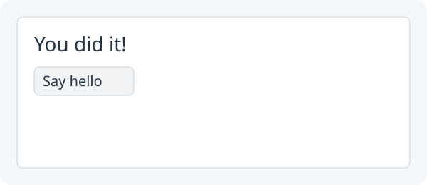

# 1. Say hello with a button

**Make a click change your greeting.**



Target illustration: the label after clicking **Say hello**.

Open your **Greeting** project from lesson 0. Keep its `Main.java`.

## 1. Add the Button and Column imports

In `Main.java`, find:

`import zero.ui.Label;`

Add below it:

```java
import zero.ui.Button;
import zero.ui.Column;
```

## 2. Create a button after the greeting in `setup()`

In `setup()`, find the greeting line (its text may be your own):

`Label greeting = new Label("Hello, Java!");`

Add below it:

```java
Button button = new Button("Say hello");
button.onClick(() -> greeting.setText("You did it!"));
```

## 3. Replace `show(greeting)` with a vertical layout

`Column` stacks the label and button with 10 pixels between them. Find:

`show(greeting);`

Replace with:

```java
show(new Column(10, greeting, button));
```

`onClick` tells Zero which code to run when the button is activated.
The `() ->` introduces that action; you do not need an event object.
The button's action changes the **existing** label. The label must stay in
`setup()` above the action so the action can use `greeting`.

## 4. Run App and click Say hello

Click **Run App**, then click **Say hello**. The label should change from **Hello, Java!** to **You did it!**. Try changing `You did it!` to your own short message and rerun. Keep this
Greeting project for lesson 2.

Next: [Greet by name](02-hello-name.md).
