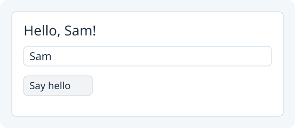

# 3. Greet by name



Target illustration: typing `Sam` and clicking **Say hello**.

Continue the **same Greeting project** you changed in lessons 1 and 2. If it is not open, choose this on the Start Page:

**Project → Open**

Select your existing project folder. If you need a local clone of your repository, choose **Project → Clone** instead.

## 1. Add this import after `import zero.ui.Label;`

Add the `TextField` import in `Main.java`; replace the matching lines with the copied code:

```java-after-2
import zero.ui.Label;
import zero.ui.TextField;
```

## 2. Create a text field before the button in `setup()`

In `setup()`, add the text field before the button by replacing the matching lines with the copied code. Keep your own greeting text if you changed it:

```java-after-2-3
        Label greeting = new Label("Hello, Java!");
        TextField name = new TextField();
        name.setPromptText("Your name");
        Button button = new Button("Say hello");
```

## 3. Change the button action to read the name

Copy the block over the matching lines in `setup()`. Your existing button message may differ:

```java-after-3-4-r2
        Button button = new Button("Say hello");
        button.onClick(() -> greeting.setText("You did it!"));
        button.onClick(() ->
                greeting.setText("Hello, " + name.getText() + "!"));
```

## 4. Put the field between the label and button

Copy the block over the matching line in `setup()`:

```java-after-2-r1
        show(new Column(10, greeting, button));
        show(new Column(10, greeting, name, button));
```

## 5. Run and try two names

`name.getText()` reads what is in the field **when the button is clicked**.
Click **Run**, type `Sam`, then click **Say hello**. The label should say **Hello, Sam!**. Try your own name and check that the greeting changes. You have now grown one project across three lessons. Next you will start a new **Coin game** project.

### Layout and appearance

`Label`, `TextField`, `Button` and `Column` come from Zero's `zero.ui`
package. In `new Column(10, greeting, name, button)`, 10 is the gap between
controls. The column arranges them without individual coordinates.

For space around the whole interface, keep `padding(20)` in Main's `settings()`
as in [lesson 1](00-hello-world.md#app-startup). It also works in `setup()` or a
button action; each call replaces the previous amount, and `padding(0)` removes
it. Padding uses some of the window's configured size, so enlarge `size(...)`
in settings if the content needs room.

Keep clear button labels and feedback near the action. Try Tab to reach the
field and button, then Space to activate the focused button. Type a second name
and check that the action reads the current text, rather than remembering the
first name. Keep keyboard focus visible and use words as well as colour to
explain results.

## 6. Save a checkpoint on your computer

Save your files. In Zero's **Project** panel, check that the branch is **main**.
Type `Finish greeting app` in the commit message field, then choose:

**Commit**

A commit saves a checkpoint on your current branch. It is available on this
computer as soon as Zero says **Committed locally**.

## 7. Send your checkpoint to GitHub

Choose:

**Sync**

Sync sends the saved commits on **main** to GitHub. When Zero confirms the
sync, click your repository name and choose **Open on GitHub**. Check that
**main** shows your commit message.

## 8. Publish your greeting

After checking that you have permission to share the contents, stop the running app. Open the Run dropdown and choose:

**Publish & open app**

Follow the prompts and wait for the app to open in
your browser. Try the button there, too. Your published page and its contents
are public; include only material you have permission to share. If publishing
is unavailable for your repository or school account, follow your school or account policy and keep your repository visibility unchanged.

Next: [Start the Coin game](08-movement.md).
