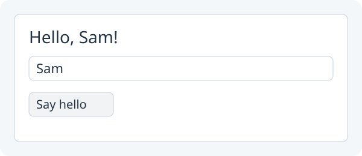

# 2. Greet by name

**Let someone type the greeting.**



Target illustration: typing `Sam` and clicking **Say hello**.

Open the **same Greeting project** you changed in lessons 0 and 1.

## 1. Add this import beside your other Zero imports

Add this import beside your other Zero imports:

```java
import zero.ui.TextField;
```

## 2. Create a text field before the button in `setup()`

In `setup()`, after the `greeting` line and before the `button` line, write:

```java
TextField name = new TextField();
name.setPromptText("Your name");
```

## 3. Change the button action to read the name

Change the button's existing action to:

```java
button.onClick(() ->
        greeting.setText("Hello, " + name.getText() + "!"));
```

## 4. Put the field between the label and button

Replace the `show(...)` line so the field appears between the other controls:

```java
show(new Column(10, greeting, name, button));
```

## 5. Run App and try two names

`name.getText()` reads what is in the field **when the button is clicked**.
Click **Run App**, type `Sam`, then click **Say hello**. The label should say **Hello, Sam!**. Try your own name and check that the greeting changes. You have now grown one project across three lessons. The
next lesson starts a new **Study** project, which you will keep through lesson 7.

### Layout and appearance

`Label`, `TextField`, `Button` and `Column` come from Zero's `zero.ui`
package. Zero uses JavaFX underneath, so these controls keep ordinary keyboard
focus and platform behavior. In `new Column(10, greeting, name, button)`, 10 is
the gap between controls. The column arranges them without individual coordinates.

For space around the whole interface, keep `padding(20)` in Main's `settings()`
as in [lesson 0](00-hello-world.md#app-startup). It also works in `setup()` or a
button action; each call replaces the previous amount, and `padding(0)` removes
it. Padding uses some of the window's configured size, so enlarge `size(...)`
in settings if the content needs room.

Keep clear button labels and feedback near the action. Try Tab to reach the
field and button, then Space to activate the focused button. Type a second name
and check that the action reads the current text, rather than remembering the
first name. Keep keyboard focus visible and use words as well as colour to
explain results.

These controls need no stylesheet. Advanced JavaFX styling is a separate path;
you do not need JavaFX imports for this project. Normal **Run App** opens the
native app. Browser export and publishing are separate actions with their own
compatibility checks. Use Zero’s API reference to inspect the available methods rather than assuming every JavaFX method is also a Zero method.

Next: [Start a tiny quiz](03-quiz.md).
