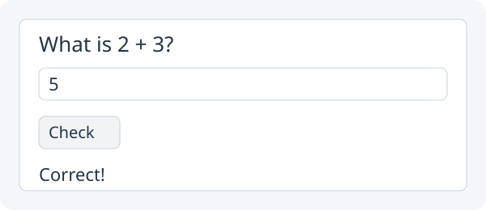

# 3. A tiny quiz

**Make an answer checker.**



Target illustration: a correct answer to your first quiz question.

[Start Study project](README.md#start-a-lesson) in a new **Study** project. Open its empty `setup()` in `Main.java`.

## 1. Add these imports above `public class Main`

Keep the generated `Main extends App`, `setup()` and `main(...)` lines.
Add these imports above the class, beside the existing `zero.App` import:

```java
import zero.ui.Button;
import zero.ui.Label;
import zero.ui.TextField;
import zero.ui.Column;
```

## 2. Add answer and feedback fields above `setup()`

The button action will need the answer and feedback later. Add these fields
inside `Main`, **above** `setup()`:

```java
private TextField answer;
private Label feedback;
```

## 3. Keep the starter’s padding

Your starter already has this method inside `Main`, above `setup()`. Keep it
to leave space around the window edges. If you started with an older template,
add it once:

```java
@Override public void settings() {
    padding(20);
}
```

`padding(20)` leaves 20 pixels on every edge. Keep this method as you grow the Study app.
The `10` in `new Column(10, ...)` sets the gaps **between** controls.
These controls come from Zero, just like the Greeting project; no JavaFX imports
are needed for the quiz.

## 4. Create and show the controls inside `setup()`

Inside `setup()`, write the controls and put them in the window:

```java
Label question = new Label("What is 2 + 3?");
answer = new TextField();
Button check = new Button("Check");
feedback = new Label("");
show(new Column(10, question, answer, check, feedback));
```

## 5. Give Check an action before `show(...)`

Before the `show(...)` line, give the button an action:

```java
check.onClick(() -> {
    if (answer.getText().equals("5")) {
        feedback.setText("Correct!");
    } else {
        feedback.setText("Try again.");
    }
});
```

## 6. Run App and check wrong and right answers

The braces after `if` run when the typed text is exactly `5`; `else` handles
other text. Click **Run App**. Check `4`: feedback should say **Try again.**. Change it to `5` and check again: feedback should say **Correct!**. Keep this same Study project through lesson 7. You will grow the quiz, then
move its working controls and actions into StudyQuiz to keep Main short. If you need to compare after trying it yourself,
see the [completed lesson 3 checkpoint](../../teaching/checkpoints/3/Main.java).

Next: [Count attempts](04-counter.md).
