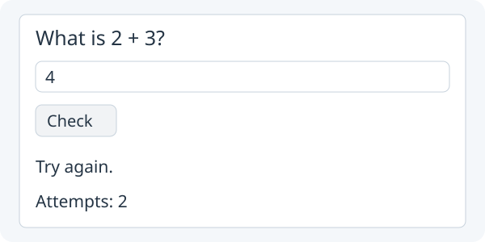

# 4. Count quiz attempts

**Count every press of Check.**



Target illustration: the same quiz after two checks.

Open your **Study** project from lesson 3. Keep its question and Check action.

## 1. Add attempts fields above `setup()`

In `Main`, above `setup()` and beside your `answer` and `feedback` fields, add:

```java
private int attempts = 0;
private Label attemptsLabel;
```

## 2. Create the attempts label in `setup()`

In `setup()`, after `feedback = new Label("");`, create the new label:

```java
attemptsLabel = new Label("Attempts: 0");
```

## 3. Add the attempts label to the layout

Add `attemptsLabel` as the **last** item in the existing `Column`:

```java
show(new Column(10, question, answer, check, feedback, attemptsLabel));
```

## 4. Count each check before the `if` statement

Inside the **existing** `check.onClick(...)` block, put these two lines
*before* the `if` statement:

```java
attempts = attempts + 1;
attemptsLabel.setText("Attempts: " + attempts);
```

## 5. Run App and check twice

`attempts` is a field because its value must survive from one click to the
next. The label shows the current value; changing the number alone does not
change the screen. Click **Run App** and check twice, using any answers. The label should show **Attempts: 2**. Keep checking answers: two wrong attempts still show
**Try again.**, and a correct answer still shows **Correct!**.

If you need to compare your result, see the [completed lesson 4 checkpoint](../../teaching/checkpoints/4/Main.java).

Next: [Add Reset with methods](05-methods.md).
