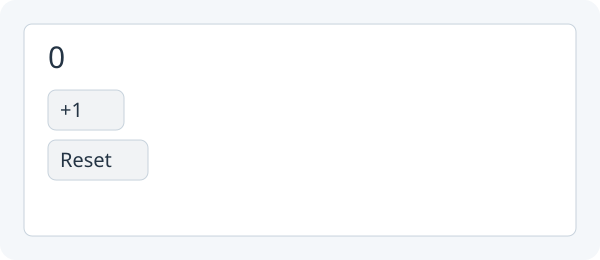

# 5. Add Reset with methods

**Give your quiz a fresh start.**



Target illustration: your quiz just after clicking **Reset**.

Open the **same Study project** from lesson 4.

## 1. Create a Reset button beside Check

The answer, feedback and attempts labels are already fields, so your new
methods can use them. In `setup()`, find:

`Button check = new Button("Check");`

Add below it:

```java
Button reset = new Button("Reset");
```

## 2. Replace the old Check action with method calls

Find the entire existing Check action, including its closing `});`:

`check.onClick(() -> {` `attempts = attempts + 1;` `attemptsLabel.setText("Attempts: " + attempts);` `if (answer.getText().equals("5")) {` `feedback.setText("Correct!");` `} else {` `feedback.setText("Try again.");` `}` `});`

Replace with:

```java
check.onClick(() -> checkAnswer());
reset.onClick(() -> resetQuiz());
```

## 3. Put Reset after Check in the layout

Find:

`show(new Column(10, question, answer, check, feedback, attemptsLabel));`

Replace with:

```java
show(new Column(10, question, answer, check, reset, feedback, attemptsLabel));
```

## 4. Move the checking code into `checkAnswer()`

Find the end of `setup()`, immediately after the layout line:

`show(new Column(10, question, answer, check, reset, feedback, attemptsLabel));` `}`

Add below that closing brace, still inside `Main`. This named method uses the
code you removed from the old Check action:

```java
private void checkAnswer() {
    attempts = attempts + 1;
    attemptsLabel.setText("Attempts: " + attempts);
    if (answer.getText().equals("5")) {
        feedback.setText("Correct!");
    } else {
        feedback.setText("Try again.");
    }
}
```

## 5. Add `resetQuiz()` beside `checkAnswer()`

Find the closing lines of `checkAnswer()`:

`feedback.setText("Try again.");` `}` `}`

Add below that method, still inside `Main`:

```java
private void resetQuiz() {
    attempts = 0;
    attemptsLabel.setText("Attempts: 0");
    answer.setText("");
    feedback.setText("");
}
```

`answer.setText("")` replaces the entered answer with an empty string.

## 6. Run App and test Reset

Do not leave the old check block in `setup()`; there should be one Check
handler. `checkAnswer()` and `resetQuiz()` name the two actions, and both
change the state and the visible controls. Click **Run App**, check twice, click **Reset**, then check once more. Attempts should go **2 → 0 → 1**; Reset should clear the answer and feedback. For comparison after building,
see the [completed lesson 5 checkpoint](../../teaching/checkpoints/5/Main.java).

Next: [Use classes to simplify Main](06-objects.md).
