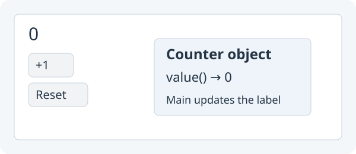

# 6. Use classes to simplify Main

**Give counting and the quiz their own classes, leaving Main small.**



Target illustration: the same quiz after Reset, with its count stored in a `Counter` object.

Open your **Study project** from lesson 5. Keep its controls and methods.

## 1. Create `Counter.java` beside `Main.java`

Create `src/main/java/Counter.java` beside `Main.java`. Write an ordinary class
with one private number and three public methods. Paste this complete code into
the new file:

```java
public class Counter {
    private int count = 0;

    public void increment() { count = count + 1; }
    public void reset() { count = 0; }
    public int value() { return count; }
}
```

## 2. Replace the attempts number with a Counter field

No special framework registration is needed. In `Main`, find:

`private int attempts = 0;`

Replace with:

```java
private final Counter attempts = new Counter();
```

## 3. Ask Counter to increment in `checkAnswer()`

In `checkAnswer()`, find:

`attempts = attempts + 1;` `attemptsLabel.setText("Attempts: " + attempts);`

Replace with:

```java
attempts.increment();
attemptsLabel.setText("Attempts: " + attempts.value());
```

## 4. Ask Counter to reset in `resetQuiz()`

In `resetQuiz()`, find:

`attempts = 0;` `attemptsLabel.setText("Attempts: 0");`

Replace with:

```java
attempts.reset();
attemptsLabel.setText("Attempts: " + attempts.value());
```

## 5. Run App and check the count after Reset

Keep the answer checking, buttons and layout from lesson 5. Counter owns the
number; Main still explicitly updates the label. Click **Run App**, check twice, click **Reset**, then check again. Attempts should go **2 → 0 → 1**. Keep this working version; next you will move the quiz controls into their own class.

## 6. Move the quiz out of Main

Counter now owns the count, but Main still contains every button, label and
quiz action. Put that related code together in an ordinary class, `StudyQuiz`.
We are reorganizing the same working quiz. Its appearance and behavior stay the
same. This is called **refactoring**.

Before this move, Main has three jobs: open the app, build the quiz, and handle
quiz actions. Afterward:

| Class | Job |
| --- | --- |
| `Main` | Open the app and show the quiz |
| `StudyQuiz` | Build quiz controls and handle Check/Reset |
| `Counter` | Remember the number of attempts |

Create `src/main/java/StudyQuiz.java` beside Main and Counter. Move the quiz's
fields, controls, `checkAnswer()` and `resetQuiz()` into it. Keep Counter.java.
These are the changes to the code you already wrote:

1. Name the class `StudyQuiz`. It does **not** extend App.
2. Change `setup()` to `public StudyQuiz()`. This is its **constructor**: Java
   runs it once when you write `new StudyQuiz()`.
3. Keep `settings()`, `main(...)` and `extends App` in Main. Do not move them.
4. Store the existing `new Column(...)` in a field called `layout`, instead of
   calling `show(...)` in this class.
5. Add `view()` to return that Column. Main will show it.

Paste this complete code into the new `StudyQuiz.java` file. Compare it to your old
Main and notice that the two quiz actions are unchanged:

```java
import zero.ui.Button;
import zero.ui.Label;
import zero.ui.TextField;
import zero.ui.Column;

public class StudyQuiz {
    private final Column layout;
    private final Counter attempts = new Counter();
    private TextField answer;
    private Label feedback;
    private Label attemptsLabel;

    public StudyQuiz() {
        Label question = new Label("What is 2 + 3?");
        answer = new TextField();
        Button check = new Button("Check");
        Button reset = new Button("Reset");
        feedback = new Label("");
        attemptsLabel = new Label("Attempts: 0");
        check.onClick(() -> checkAnswer());
        reset.onClick(() -> resetQuiz());
        layout = new Column(10, question, answer, check, reset, feedback, attemptsLabel);
    }

    public Column view() {
        return layout;
    }

    private void checkAnswer() {
        attempts.increment();
        attemptsLabel.setText("Attempts: " + attempts.value());
        if (answer.getText().equals("5")) {
            feedback.setText("Correct!");
        } else {
            feedback.setText("Try again.");
        }
    }

    private void resetQuiz() {
        attempts.reset();
        attemptsLabel.setText("Attempts: " + attempts.value());
        answer.setText("");
        feedback.setText("");
    }

}
```

The fields stay in StudyQuiz because its button actions need to use them after
the constructor finishes. `layout` is the same Column you already know; `view()`
just gives Main that layout. You are choosing an ordinary method name, not
registering a component with Zero.

## 7. Leave only app startup in Main

Replace the entire contents of `Main.java` with the complete code below. This
removes the moved quiz fields, controls and action methods; its only remaining
field is the quiz object:

```java
import zero.App;

public class Main extends App {
    private StudyQuiz quiz;

    @Override public void settings() {
        padding(20);
    }

    @Override public void setup() {
        quiz = new StudyQuiz();
        show(quiz.view());
    }

    public static void main(String[] args) { launch(args); }
}
```

`new StudyQuiz()` creates the object and builds its controls. `quiz.view()` asks
for its Column. `show(...)` is the Zero App method that puts it in the window.
There is still only one App: Main. StudyQuiz is an object inside it.

## 8. Check that refactoring changed no behavior

Run App again. Check `4`, then `5`: Attempts is 2 and feedback says Correct.
Reset clears the answer, feedback and count; another check gives Attempts 1.
These are the same checks you ran before moving the code.

Try changing the Check button's text in StudyQuiz. Run again and see it change
without editing Main; restore Check afterward. To change app padding, edit Main's
`settings()`. The file to open now depends on the job you want to change.

For comparison after trying the move, see [Main](../../teaching/checkpoints/6/Main.java),
[StudyQuiz](../../teaching/checkpoints/6/StudyQuiz.java) and
[Counter](../../teaching/checkpoints/6/Counter.java).

Next: [Grow StudyQuiz with Question objects](07-study-app.md).
