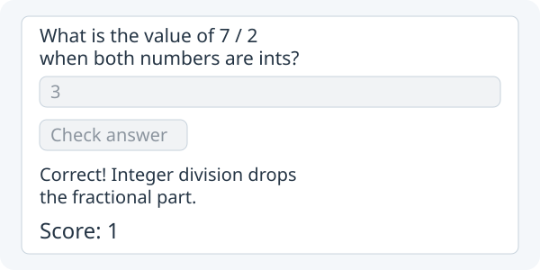

# 7. Build a study app

**Turn your quiz into a three-question session.**



Target illustration: question 1 answered correctly after one wrong try.

Open the **same Study project** from lesson 6. Keep Main's small startup code,
StudyQuiz.java and Counter.java. If your Main still holds the Check/Reset code,
finish [moving that code into StudyQuiz](06-objects.md#6-move-the-quiz-out-of-main)
first. In this lesson, Main stays unchanged: you grow StudyQuiz and add Question.

| Class | Job |
| --- | --- |
| `Main` | Show the quiz |
| `StudyQuiz` | Own controls, score and question progression |
| `Question` | Store one prompt/answer/explanation and check a response |
| `Counter` | Count attempts |

Question and Counter are smaller objects used by StudyQuiz. Neither needs to
extend StudyQuiz or App.

## 1. Give each question its own data

Create `src/main/java/Question.java` beside Main, StudyQuiz and Counter. Write this
ordinary Java class. Its `accepts(...)` method ignores surrounding spaces and
letter case, so ` TRUE ` can answer `true`.

```java
public class Question {
    private final String prompt;
    private final String answer;
    private final String explanation;

    public Question(String prompt, String answer, String explanation) {
        this.prompt = prompt;
        this.answer = answer;
        this.explanation = explanation;
    }

    public String prompt() { return prompt; }
    public String explanation() { return explanation; }
    public boolean accepts(String response) {
        return answer.equalsIgnoreCase(response.trim());
    }
}
```

## 2. Add session state to StudyQuiz

Keep `settings()` and `padding(20)` in Main. In **StudyQuiz.java**, keep the
`layout`, `Counter attempts`, `answer`, `feedback` and `attemptsLabel` fields.
Find this field in `StudyQuiz.java`:

`private Label attemptsLabel;`

**Add below:**

```java
private final Question[] questions = {
        new Question("What is 2 + 3?", "5", "2 + 3 equals 5."),
        new Question("What is 9 % 4?", "1", "The remainder is 1."),
        new Question("Is 2 < 3? (true or false)", "true", "2 is less than 3.")
};
private int questionIndex = 0;
private int points = 0;
private boolean answered = false;
private boolean finished = false;
private Label questionLabel;
private Label scoreLabel;
private Button check;
private Button next;
private Button restart;
```

The array stores three ordinary Question objects. `questionIndex` selects one.
`points` stays in StudyQuiz because StudyQuiz owns the quiz rules. `answered` stops a
second point for the same question; `finished` stops checking after completion.

## 3. Update the StudyQuiz constructor

In `public StudyQuiz()`, **find this:**

`Label question = new Label("What is 2 + 3?");`

**Replace with:**

```java
questionLabel = new Label("");
```

## 4. Create Next, Restart and score controls

**Find these lines** in the constructor:

`Button check = new Button("Check");` `Button reset = new Button("Reset");`

**Replace with:**

```java
check = new Button("Check");
next = new Button("Next");
restart = new Button("Restart");
scoreLabel = new Label("");
```


## 5. Connect the actions and replace the layout

Keep your `answer`, `feedback` and `attemptsLabel` creation lines. **Find these lines** in the constructor:

`check.onClick(() -> checkAnswer());` `reset.onClick(() -> resetQuiz());` `layout = new Column(10, question, answer, check, reset, feedback, attemptsLabel);`

**Replace with:**

```java
check.onClick(() -> checkAnswer());
next.onClick(() -> nextQuestion());
restart.onClick(() -> restartSession());
layout = new Column(10, questionLabel, answer, check, next, restart,
        feedback, attemptsLabel, scoreLabel);
showQuestion();
refreshStats();
```

There should be one `check.onClick(...)` line. Remove the old
`reset.onClick(...)` and old `layout = ...` line. Keep `view()` unchanged.

## 6. Check once, then move forward

**Find this entire method** in StudyQuiz:

`private void checkAnswer() {` `attempts.increment();` `attemptsLabel.setText("Attempts: " + attempts.value());` `if (answer.getText().equals("5")) {` `feedback.setText("Correct!");` `} else {` `feedback.setText("Try again.");` `}` `}`

**Replace with:**

```java
private void checkAnswer() {
    if (answered || finished) return;
    attempts.increment();
    if (questions[questionIndex].accepts(answer.getText())) {
        answered = true;
        points = points + 1;
        feedback.setText("Correct! " + questions[questionIndex].explanation());
        check.setEnabled(false);
        next.setEnabled(true);
    } else {
        feedback.setText("Try again.");
    }
    refreshStats();
}
```

`check.setEnabled(false)` makes Check unavailable; `next.setEnabled(true)`
makes Next available. The booleans `answered` and `finished` still protect the
quiz rules. Disabling a button reflects that state; it does not replace it.

## 7. Add methods to advance and show questions

**Find** the closing brace of the `checkAnswer()` method you just replaced. **Add below** that method, still inside StudyQuiz:

```java
private void nextQuestion() {
    if (!answered || finished) return;
    if (questionIndex == questions.length - 1) {
        finished = true;
        questionLabel.setText("Finished! Score: " + points + " / " + questions.length);
        answer.setEnabled(false);
        check.setEnabled(false);
        next.setEnabled(false);
        feedback.setText("Choose Restart to try again.");
        return;
    }
    questionIndex = questionIndex + 1;
    answered = false;
    showQuestion();
}

private void showQuestion() {
    questionLabel.setText("Question " + (questionIndex + 1) + " of "
            + questions.length + ": " + questions[questionIndex].prompt());
    answer.setText("");
    answer.setEnabled(true);
    check.setEnabled(true);
    next.setEnabled(false);
    feedback.setText("");
}
```

At the last question, Next shows the completion message. At any new question,
`showQuestion()` clears the previous answer and keeps Next disabled until the
new answer is correct. The controls are reused; StudyQuiz does not rebuild them or create another App.

## 8. Add methods to restart and refresh stats

**Find this entire method:**

`private void resetQuiz() {` `attempts.reset();` `attemptsLabel.setText("Attempts: " + attempts.value());` `answer.setText("");` `feedback.setText("");` `}`

**Replace with:**

```java
private void restartSession() {
    questionIndex = 0;
    points = 0;
    answered = false;
    finished = false;
    attempts.reset();
    showQuestion();
    refreshStats();
}

private void refreshStats() {
    attemptsLabel.setText("Attempts: " + attempts.value());
    scoreLabel.setText("Score: " + points);
}
```

## 9. Run App and test the whole session

Click **Run App**. Try `4`, then `5`: feedback changes, Attempts is 2, Score is 1, and Check is
disabled. Click Next and answer `1`, then Next and answer ` TRUE `, then Next.
The end says **Finished! Score: 3 / 3**. Restart; expect question 1, empty
input, Attempts 0, Score 0 and disabled Next. After a correct
answer, try Check again: the button is disabled and the score stays at 1.

If you need to compare after making your edits, see the completed lesson 7
[Main](../../teaching/checkpoints/7/Main.java),
[StudyQuiz](../../teaching/checkpoints/7/StudyQuiz.java),
[Counter](../../teaching/checkpoints/7/Counter.java) and
[Question](../../teaching/checkpoints/7/Question.java). They are reference
checkpoints, not files you need to replace your project with.

**Challenge:** Add a fourth `Question` to the array in StudyQuiz, including its answer and
explanation. `questions.length` makes the labels and completion count adjust.

Next: [Start a movement game](08-movement.md).
