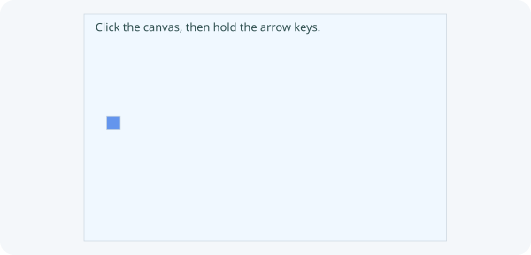

# 5. Move a player

**First checkpoint: a square you can move.**



[Start the Coin game project](README.md#start-a-lesson) once. Its `Main.java` has empty `setup()`, `update(double seconds)` and `draw()` methods, and no Player class. Keep this folder for lessons 6 and 9–11; there is no new game download for the next lesson.

Previous: [Your Greeting app](02-hello-name.md).

## 1. Write Player.java

Create `src/main/java/Player.java`. Player owns position; Main decides when to update and draw it. Type this class, then try changing its color or speed:

```java
import zero.Color;
import zero.GameApp;

public class Player {
    private double x;
    private double y;
    private final double size = 24;
    private final double speed = 180;

    public Player(double startX, double startY) {
        x = startX;
        y = startY;
    }

    public void update(int horizontal, int vertical, double seconds,
                       double canvasWidth, double canvasHeight) {
        x += horizontal * speed * seconds;
        y += vertical * speed * seconds;
        x = Math.max(0, Math.min(x, canvasWidth - size));
        y = Math.max(0, Math.min(y, canvasHeight - size));
    }

    public void draw(GameApp app) {
        app.fill(Color.rgb(100, 149, 237));
        app.rect(x, y, size, size);
    }
}
```

The `Math.max`/`Math.min` lines keep the whole square on screen. `x` and `y` are its top-left corner. At 180 pixels per second, a 0.05-second update moves 9 pixels.

## 2. Connect Player to your existing Main

In `Main.java`, **find:**

`import zero.GameApp;`

**Add above:**

```java
import zero.Key;
import zero.Color;
```

`Key` names the four arrow keys. `Color.rgb(red, green, blue)` mixes amounts from 0 to 255; `Color.BLUE` and `Color.GOLD` are ready-made colours. **Find:**

`public class Main extends GameApp {`

**Add below:**

```java
private Player player;
```

**Find the three empty methods** in the starter:

`@Override public void setup() {` `// Create your game objects here.` `}`  `@Override public void update(double seconds) {` `// Update your objects here.` `}`  `@Override public void draw() {` `// Draw your game here.` `}`

**Replace those methods with:**

```java
@Override public void setup() {
    player = new Player(40, 180);
}

@Override public void update(double seconds) {
    int horizontal = 0;
    int vertical = 0;
    if (keyDown(Key.LEFT)) horizontal--;
    if (keyDown(Key.RIGHT)) horizontal++;
    if (keyDown(Key.UP)) vertical--;
    if (keyDown(Key.DOWN)) vertical++;
    player.update(horizontal, vertical, seconds, width(), height());
}

@Override public void draw() {
    background(Color.rgb(240, 248, 255));
    fill(Color.rgb(47, 79, 79));
    textSize(20);
    text("Click the canvas, then hold the arrow keys.", 20, 30);
    player.draw(this);
}
```

Keep the starter's `settings()` and `main(...)`. `GameApp` calls update and draw each frame; it does not find Player automatically. Main reads keys and explicitly calls Player. Click the canvas for keyboard focus. Switching windows clears held keys; click the canvas again to resume.

### Frames, input and canvas

GameApp extends App. Startup runs `settings()`, creates the canvas, runs
`setup()`, then shows the window and starts frames. Create your objects once in
setup. Each frame calls Main's `update(seconds)` before `draw()`; Main calls its
objects explicitly. App alone has no frame loop.

`seconds` measures elapsed time, so `speed * seconds` gives movement in pixels
at a speed measured in pixels per second. Frame rate can vary. The first frame
receives 0 seconds; later values are capped at 0.1 after a long delay. Keep frame
methods short so JavaFX can handle input and display the next frame.

Canvas coordinates start at `(0, 0)` in the top left: x increases rightward and
y downward. `width()` and `height()` return canvas dimensions, available in setup
and later. `size(...)` in settings chooses those fixed dimensions; resizing the
window does not scale the canvas. The starter’s `padding(20)` leaves space
around it. Initial padding grows the game window while preserving the
640 by 400 canvas dimensions and all game coordinates.

`keyDown(...)` reports a held key while the canvas has focus. Typing in a text
field belongs to that control. Focus loss clears held input but does not pause
the frame loop. For pointer experiments, `mouseX()` and `mouseY()` report the
tracked canvas position. For the primary pointer button, `mouseDown()` reports
whether it is held and `mousePressed()` reports a new press during the current
update. These queries need no JavaFX import.

The canvas keeps its pixels until you draw over them. `background(...)` clears
it for each fresh frame; `fill(...)` chooses the colour for following filled
shapes and text. Drawing styles persist until changed. `textSize(...)` chooses
the default font at that size, and the y coordinate in `text(...)` is its
baseline. A JavaFX control stylesheet does not style these drawn pixels.

### How Player uses the app to draw

Main extends `GameApp`, so it can call drawing methods such as `background(...)`
directly. Player is an ordinary Java class. To draw, it needs access to the
running app and its canvas. This line inside Main's `draw()` provides that access:

```java
player.draw(this);
```

Here, `this` means the current Main object. Since Main extends `GameApp`, Java
allows it as the argument to Player's `draw(GameApp app)` method. The parameter
`app` refers to that same Main object; passing it creates no new app or canvas.

Look again at the method you already wrote in Player:

```java
public void draw(GameApp app) {
    app.fill(Color.rgb(100, 149, 237));
    app.rect(x, y, size, size);
}
```

`app.fill(...)` chooses the colour on the app's canvas, and `app.rect(...)` draws
Player's square there using Player's own position and size. Main draws the
background first, then Player draws on the same canvas. Keep Player as
`public class Player`: it uses the existing app through a parameter, so it does
not need to extend `GameApp`.

## 3. Run App and check movement

Click **Run App**, click the canvas, then hold and release an arrow key. The square should move while held and stop when released. Try every edge, Right + Up, Left + Right, and releasing all keys. Change `speed` to 90, run again, compare, then restore 180. Change `size` to 40 and check that the whole square remains visible; restore 24 before lesson 6. If you remove only `player.update(...)`, the square still draws but cannot move. Explain why.

After writing your own code, compare with checkpoint 8's [Main.java](../../teaching/checkpoints/8/Main.java) and [Player.java](../../teaching/checkpoints/8/Player.java). Continue editing **this Coin game folder** in [lesson 6](09-coin-game.md).
