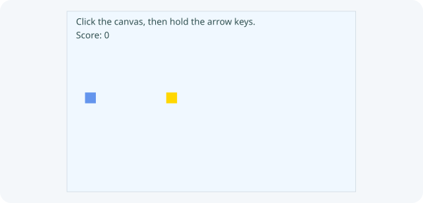

# 5. Build a coin game

**First checkpoint: collect one coin exactly once.**



Continue the **same Coin game project** from lesson 4. If it is not open, choose this on the Start Page:

**Project → Open**

Select your existing project folder. If you need a local clone of your repository, choose **Project → Clone** instead. Keep the Player and Main you wrote.

Previous: [Move a player](08-movement.md).

## 1. Add a contact method before `draw()`

In `Player.java`, add `touches` before `draw`; replace the matching lines with the copied code:

```java-after-1-2-3-4
    public boolean touches(double otherX, double otherY, double otherSize) {
        return x + size >= otherX && x <= otherX + otherSize
                && y + size >= otherY && y <= otherY + otherSize;
    }
    public void draw(GameApp app) {
```

Both horizontal and vertical ranges must meet. The comparisons count touching an edge.

## 2. Write Coin.java

In Project Explorer, right-click **java** and choose:

**New class…**

Name the class `Coin` and write `java/Coin.java`. Coin owns its position and collection state; Main owns the score.

```java
import zero.Color;
import zero.GameApp;

public class Coin {
    private final double x;
    private final double y;
    private final double size = 24;
    private boolean collected;

    public Coin(double x, double y) {
        this.x = x;
        this.y = y;
    }

    public boolean isCollected() { return collected; }
    public boolean touches(Player player) { return player.touches(x, y, size); }
    public void collect() { collected = true; }

    public void draw(GameApp app) {
        if (collected) return;
        app.fill(Color.GOLD);
        app.rect(x, y, size, size);
    }
}
```

## 3. Collect one coin

In `Main.java`, add the coin and points fields; replace the matching lines with the copied code:

```java-after-2-3
    private Player player;
    private Coin coin;
    private int points;
```

## 4. Place the coin

In `setup()`, add the coin assignment; replace the matching lines with the copied code:

```java-after-2
        player = new Player(40, 180);
        coin = new Coin(220, 180);
```

## 5. Collect the coin on contact

In `update()`, add the collection check; replace the matching lines with the copied code:

```java-after-2-3-4-5
        player.update(horizontal, vertical, seconds, width(), height());
        if (!coin.isCollected() && coin.touches(player)) {
            coin.collect();
            points++;
        }
```

## 6. Draw the score and coin before the player

In `draw()`, add the score and coin drawing before the player; replace the matching lines with the copied code:

```java-after-1-2
        text("Score: " + points, 20, 60);
        coin.draw(this);
        player.draw(this);
```

## 7. Run and collect the coin once

If the movement demo from lesson 4 is still running, choose **Stop**. Then
choose **Run** and click the canvas. Touch the coin, stay there, leave, and
return. The coin should disappear and the score should become 1 only once.
The `!coin.isCollected()` check prevents a point every frame. If you remove
it, contact can repeatedly score even though Coin no longer draws. Put it back
before saving the working game.

## 8. Save the one-coin game on main

Stop the game and save your files. In the **Project** panel, check that **main**
is selected. Enter `Collect one coin` in the commit message field, then choose:

**Commit**

Once Zero confirms the local commit, choose:

**Sync**

When Sync finishes, click your repository name and choose **Open on GitHub**.
Check that **main** shows `Collect one coin`.

## 9. Start a branch for the next version

A branch lets you build the next version while **main** keeps the working
one-coin game. In the **Project** panel, click **main**, then choose:

**New branch…**

Enter `coin-score` and press Enter. Check that `coin-score` is selected. The
next two commits will save working versions on this branch.

## 10. Add a score and Restart below the canvas

Zero controls can sit below the canvas. In `Main.java`, add the control imports; replace the matching lines with the copied code:

```java-after-2-3-4
import zero.GameApp;
import zero.ui.Button;
import zero.ui.Label;
import zero.ui.Row;
```

## 11. Add label fields

In `Main.java`, add the label fields; replace the matching lines with the copied code:

```java-after-2-3
    private int points;
    private Label scoreLabel;
    private Label message;
```

## 12. Create the controls

In `setup()`, replace the two assignments with controls created once and a call to `restart()`. Copy the block over the matching lines:

```java-after-3-4-5-6-7-8-r1-2
        player = new Player(40, 180);
        coin = new Coin(220, 180);
        scoreLabel = new Label("");
        message = new Label("");
        var restartButton = new Button("Restart");
        restartButton.onClick(() -> restart());
        controls(new Row(12, scoreLabel, message, restartButton));
        restart();
```

## 13. Move the starting state into `restart()`

The two assignments you replaced now belong in `restart()`. Add the method below `setup()` by replacing the matching lines with the copied code:

```java-after-3-4-5-6-7-8-9-10
        restart();
    }
    public void restart() {
        player = new Player(40, 180);
        coin = new Coin(220, 180);
        points = 0;
        scoreLabel.setText("Score: 0");
        message.setText("Collect the gold square.");
        showGame();
    }
```

## 14. Update the score label after collection

In `update()`, add the score label update; replace the matching lines with the copied code:

```java-after-2
            points++;
            scoreLabel.setText("Score: " + points);
```

In `draw()`, **find and remove** the old canvas score line:

`text("Score: " + points, 20, 60);`

Restart should restore the coin, Player's position and score without creating another control row. `showGame()` returns keyboard focus to the retained canvas and clears held input; it keeps the existing control row. It also works here when the game is already showing.

## 15. Test and commit the score and Restart

Choose **Run**. Check that the score below the canvas starts at 0 and changes
to 1 when you collect the coin. Stay on the coin to check that it scores only
once. Click **Restart**. The coin and the player's starting position should
return, and the score should reset to 0. Collect the coin again to check
that Restart set up a fresh game.

Choose **Stop** and save your files on `coin-score`. Enter
`Add score and Restart controls` and choose:

**Commit**

This checkpoint is saved on `coin-score`. Stay on the branch for the next change.

## 16. Grow to three coins and a win

In `Main`, copy the block over the matching field:

```java-after-2-3-r1
    private Coin coin;
    private Coin[] coins;
    private boolean won;
```

In `restart()`, copy the block over the matching assignment:

```java-after-2-3-4-5-6-r1
        coin = new Coin(220, 180);
        coins = new Coin[] {
            new Coin(220, 180), new Coin(420, 80), new Coin(540, 300)
        };
        won = false;
        message.setText("Collect all " + coins.length + " coins.");
```

## 17. Stop movement after collecting every coin

In `restart()`, **find and remove** the earlier message line:

`message.setText("Collect the gold square.");`

At the start of `update()`, replace the matching line with the copied code:

```java-after-2
    @Override public void update(double seconds) {
        if (won) return;
```

In `update()`, copy the block over the existing coin collection check:

```java-after-6-7-8-9-10-11-12-13-14-15-16-r1-2-3-4-5
        if (!coin.isCollected() && coin.touches(player)) {
            coin.collect();
            points++;
            scoreLabel.setText("Score: " + points);
        }
        for (Coin each : coins) {
            if (!each.isCollected() && each.touches(player)) {
                each.collect();
                points++;
                scoreLabel.setText("Score: " + points);
            }
        }
        if (points == coins.length) {
            won = true;
            message.setText("You win! Choose Restart.");
        }
```

## 18. Test and commit three coins and winning

In `draw()`, copy the block over the matching line:

```java-after-2-r1
        coin.draw(this);
        for (Coin each : coins) each.draw(this);
```

Main still explicitly updates Player and draws every object. Choose **Run**.
Try Restart before collecting, after one coin and after winning. Each Restart
should return the score to 0 with all three coins visible. When the score
reaches 3, check for the win message and confirm that movement stops until
Restart. If you change a coin's coordinates, keep each 24-pixel square within
x 0–616 and y 0–376, then run these checks again.

Save your files on `coin-score`, enter `Add three coins and a win condition`, and choose:

**Commit**

After writing it, compare with checkpoint 9's [Main.java](../../teaching/checkpoints/9/Main.java), [Player.java](../../teaching/checkpoints/9/Player.java) and [Coin.java](../../teaching/checkpoints/9/Coin.java). Keep this project if you later try the optional [component lessons](10-components.md).

## 19. Sync and merge your branch

Stop the game. With `coin-score` selected, choose:

**Sync**

The first Sync creates `coin-score` on GitHub and sends both saved commits.
When Sync finishes, open your repository on GitHub, switch to `coin-score` and
check its commit history for both messages.

In Zero, choose **Merge** beside the branch name and confirm
**Merge coin-score into main?** Zero merges the branch and syncs **main** to
GitHub.

## 20. Test the merged game on main

Check that **main** is selected in Zero. Choose **Run**, collect all three
coins and check for the win message. Try Restart and check that the score
returns to 0 and the player can move again. Check that GitHub **main** shows
the finished game before publishing.

## 21. Publish your game

After checking that you have permission to share the contents, stop the running app. Open the Run dropdown and choose:

**Publish & open app**

Wait for it to open. Play the
game in your browser and try Restart. The published page and its contents are
public, so include only material you have permission to share. If publication
is unavailable for your repository or school account, follow your school or account policy and keep your repository visibility unchanged.

Next: [Make a pet game](13-pet.md).
