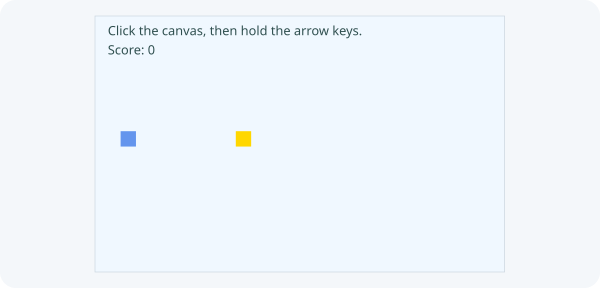

# 9. Build a coin game

**First checkpoint: collect one coin exactly once.**



Reopen the **same Coin game project** from lesson 8. Keep the Player and Main you wrote.

Previous: [Move a player](08-movement.md).

## 1. Give Player a contact method

Inside your existing `Player.java`, add this method before `draw(...)`:

```java
public boolean touches(double otherX, double otherY, double otherSize) {
    return x + size >= otherX && x <= otherX + otherSize
            && y + size >= otherY && y <= otherY + otherSize;
}
```

Both horizontal and vertical ranges must meet. The comparisons count touching an edge.

## 2. Write Coin.java

Create `src/main/java/Coin.java` yourself. Coin owns its position and collection state; Main owns the score.

```java
import zero.Color;
import zero.GameApp;

public class Coin {
    private final double x;
    private final double y;
    private final double size = 24;
    private boolean collected;

    public Coin(double x, double y) {
        this.x = x;
        this.y = y;
    }

    public boolean isCollected() { return collected; }
    public boolean touches(Player player) { return player.touches(x, y, size); }
    public void collect() { collected = true; }

    public void draw(GameApp app) {
        if (collected) return;
        app.fill(Color.GOLD);
        app.rect(x, y, size, size);
    }
}
```

## 3. Collect one coin

In your existing Main, add fields `private Coin coin;` and `private int points;`. In `setup()`, after creating Player, add `coin = new Coin(220, 180);`. At the end of `update()`, after `player.update(...)`, add:

```java
if (!coin.isCollected() && coin.touches(player)) {
    coin.collect();
    points++;
}
```

## 4. Draw the score and coin before the player

In `draw()`, just before `player.draw(this);`, add:

```java
fill(Color.rgb(47, 79, 79));
text("Score: " + points, 20, 60);
coin.draw(this);
```

## 5. Run App and collect the coin once

Click **Run App**. Touch the coin, stay there, leave, and return. The coin should disappear and the score should become 1 only once. The `!coin.isCollected()` check prevents a point every frame. If you remove it, contact can repeatedly score even though Coin no longer draws. Put it back before continuing.

## 6. Add a score and Restart below the canvas

Zero controls can sit below the canvas. Add imports for `zero.ui.Button`, `zero.ui.Label`, and `zero.ui.Row`. Add fields `private Label scoreLabel;` and `private Label message;`. In `setup()`, create controls **once**, then call a new `restart()` method:

```java
scoreLabel = new Label("");
message = new Label("");
var restartButton = new Button("Restart");
restartButton.onClick(() -> restart());
controls(new Row(12, scoreLabel, message, restartButton));
restart();
```

## 7. Move the starting state into `restart()`

Remove the old `player = ...` and `coin = ...` lines from `setup()`; put them in `restart()`. Add this method to Main:

```java
public void restart() {
    player = new Player(40, 180);
    coin = new Coin(220, 180);
    points = 0;
    scoreLabel.setText("Score: 0");
    message.setText("Collect the gold square.");
    showGame();
}
```

## 8. Update the score label after collection

When a coin is collected, immediately after `points++`, add `scoreLabel.setText("Score: " + points);`. Remove the canvas score `text(...)` line from `draw()`. Restart should restore the coin, Player's position and score without creating another control row. `showGame()` returns keyboard focus to the retained canvas and clears held input; it keeps the existing control row. It also works here when the game is already showing.

## 9. Grow to three coins and a win

Replace the field `private Coin coin;` with `private Coin[] coins;`, and add `private boolean won;`. In `restart()`, replace the one coin assignment with:

```java
coins = new Coin[] {
    new Coin(220, 180), new Coin(420, 80), new Coin(540, 300)
};
won = false;
message.setText("Collect all " + coins.length + " coins.");
```

## 10. Stop movement after collecting every coin

Remove the earlier `message.setText("Collect the gold square.");`. At the start of `update()`, add `if (won) return;`. Replace the single-coin contact block with:

```java
for (Coin each : coins) {
    if (!each.isCollected() && each.touches(player)) {
        each.collect();
        points++;
        scoreLabel.setText("Score: " + points);
    }
}
if (points == coins.length) {
    won = true;
    message.setText("You win! Choose Restart.");
}
```

## 11. Draw all coins, then test Restart and winning

Replace `coin.draw(this);` with `for (Coin each : coins) each.draw(this);`. Main still explicitly updates Player and draws every object. Click **Run App**. Try Restart before collecting, after one coin and after winning. Each run should return to 0 with all three coins visible; winning stops movement until Restart. Change a coin's coordinates to make your own level. Keep each 24-pixel square within x 0–616 and y 0–376.

After writing it, compare with checkpoint 9's [Main.java](../../teaching/checkpoints/9/Main.java), [Player.java](../../teaching/checkpoints/9/Player.java) and [Coin.java](../../teaching/checkpoints/9/Coin.java). Keep this project open for [lesson 10](10-components.md); there is no new game starter.
