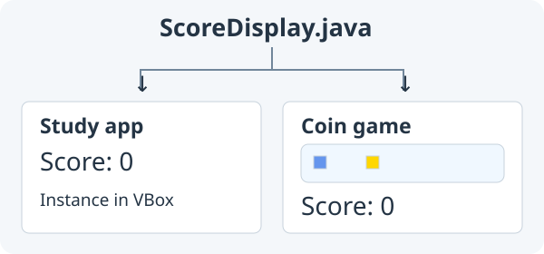

# 10. Refactor a busy Main

**First checkpoint: move input into one ordinary class and keep the game behaving the same.**



Reopen your **Coin game** from lesson 9. Later, reopen your **Study quiz** from lesson 7. Keep both existing tutorial repositories; lesson 10 has no starter download or new game.

Previous: [Build a coin game](09-coin-game.md).

## 1. Find one job to extract

Your Coin game's Main now reads keys, moves Player, checks coins, tracks points,
changes labels and draws. Those jobs work, but the class is getting busy.
A **refactor** changes how code is organized while preserving its behaviour.
Run the unchanged game using the checks in step 4 and record the results first.
Then start with the six input lines inside Main's `update(double seconds)`:

```java
int horizontal = 0;
int vertical = 0;
if (keyDown(Key.LEFT)) horizontal--;
if (keyDown(Key.RIGHT)) horizontal++;
if (keyDown(Key.UP)) vertical--;
if (keyDown(Key.DOWN)) vertical++;
```

They answer two questions: which horizontal direction and which vertical direction
is held? Player already accepts those answers. Give input its own class without
changing Player's movement, coin positions, scoring, win rule or Restart.

## 2. Write PlayerInput.java

Create `src/main/java/PlayerInput.java` in the same game folder as Main and Player:

```java
import zero.GameApp;
import zero.Key;

public class PlayerInput {
    private final GameApp game;

    public PlayerInput(GameApp game) {
        this.game = game;
    }

    public int horizontal() {
        int direction = 0;
        if (game.keyDown(Key.LEFT)) direction--;
        if (game.keyDown(Key.RIGHT)) direction++;
        return direction;
    }

    public int vertical() {
        int direction = 0;
        if (game.keyDown(Key.UP)) direction--;
        if (game.keyDown(Key.DOWN)) direction++;
        return direction;
    }
}
```

Each method returns -1, 0 or 1. Left and Right together cancel; so do Up and Down.
The constructor stores a reference to the existing GameApp. `final` prevents
replacing that reference; it does not freeze the app's changing input state.
PlayerInput is your ordinary Java class, with no superclass or framework callback.

## 3. Make Main ask for directions

Add `private PlayerInput input;` beside Main's other fields. At the beginning of
its existing `setup()`, create the helper once:

```java
input = new PlayerInput(this);
```

As with `player.draw(this)`, `this` is the running Main object, which is a GameApp.
Remove `import zero.Key;` from Main; PlayerInput now uses that import. In update,
replace the six input lines with the two calls below. Keep the existing win guard,
Player call and coin checks in their existing order:

```java
if (won) return;
int horizontal = input.horizontal();
int vertical = input.vertical();
player.update(horizontal, vertical, seconds, width(), height());
```

Read directions on every update. Reading them once in setup would remember only
startup input. Keep the same PlayerInput when Restart creates a new Player:
it refers to the app, not that Player. Main still calls Player's update exactly
once per frame. PlayerInput reads keys only; it starts no timer and never moves
Player. A second update owner could move Player twice and make speed depend on
which paths ran.

## 4. Run App and prove the refactor kept behaviour

Before adding a feature, run the game and check the same cases as before:

- Click the canvas; hold and release each arrow. Movement stops on release and
  the whole square stays inside every edge.
- Hold Right + Up for diagonal movement. Left + Right cancels horizontal motion;
  Up + Down cancels vertical motion. Release all keys and check that movement stops.
- Hold an arrow, switch to another window, then return and click the canvas.
  No old held key should keep moving the Player.
- Collect a coin and stay on it: it scores once. Restart before winning and after
  collecting all three; points, coins and Player's position reset as before.

Player still applies its existing speed separately to x and y, so diagonal travel
is faster than travel along one axis. Preserve that rule in this refactor.
Changing the speed rule would be a separate feature with its own checks.
If behaviour changed, compare the old and new direction calculations first.

You have made one responsibility smaller. Next extract the score presentation and
reuse it in the Study quiz you already wrote.

## 5. Extract the display from your study quiz

Open the `src/main/java/Main.java` you wrote in lesson 7. Main owns `points`, and its `refreshStats()` currently sets `scoreLabel.setText("Score: " + points);`. Create `src/main/java/ScoreDisplay.java` in that **study** folder:

```java
import zero.ui.Element;
import zero.ui.Label;

public class ScoreDisplay {
    private final Label label = new Label("Score: 0");

    public void setScore(int points) {
        label.setText("Score: " + points);
    }

    public Element view() {
        return label;
    }
}
```

## 6. Replace the study Main display calls

In study Main, change the field `private Label scoreLabel;` to `private ScoreDisplay score;`. In `setup()`, replace `scoreLabel = new Label("");` with `score = new ScoreDisplay();` and place `score.view()` in the existing `Column` where `scoreLabel` was. In `refreshStats()`, replace `scoreLabel.setText("Score: " + points);` with `score.setScore(points);`. Keep `points`, question rules, `Counter`, and Restart in Main.

## 7. Run App and test the study quiz

Run App: a wrong answer leaves score 0; answer `5` for the first question to reach 1; Restart returns to 0. The quiz has more questions; finish and restart it again.

Each `new ScoreDisplay()` creates one Label through the field initializer. Java supplies the no-argument constructor because you have not written another constructor. `view()` returns an Element that Main can place in a Column or Row. Label is an Element; ScoreDisplay remains an ordinary class. `setScore(int)` changes the label explicitly. No framework registration, component subclass or hidden update is involved.

## 8. Use the same class in your Coin game

Copy **your own** `ScoreDisplay.java` from the study folder into your existing Coin game's `src/main/java/`. Do not copy a new Main or Player. In the game's Main, change `private Label scoreLabel;` to `private ScoreDisplay score;`. In `setup()`, use `score = new ScoreDisplay();` and replace `scoreLabel` in the existing `Row` with `score.view()`. In `restart()` and after `points++`, change each score-label update to `score.setScore(points);`. Keep that reset call after setting `points = 0`, and keep `showGame()` at the end of Restart.

## 9. Run App and test the Coin game

Leave the message Label and game rules in Main. Run App: collect a coin and stay on it (`Score: 1`), Restart during play (`Score: 0`), collect all three (`Score: 3`), then Restart after winning. Each running app has its own ScoreDisplay object and Zero Label. An Element belongs to one parent, so you reuse the **class source**, not one live Label across windows.

## 10. Improve one class, then check both uses

Try changing the displayed word from Score to Points. In ScoreDisplay, change both the label initializer and setScore text:

```java
private final Label label = new Label("Points: 0");

public void setScore(int points) {
    label.setText("Points: " + points);
}
```

Copy that one changed class into the other project. Leave Main's score and rules alone.

## 11. Run both apps and check the shared change

Run both. Each now says Points, while scoring and Restart still work. If one project still looks unchanged, check which copy of `ScoreDisplay.java` you edited and rerun that project. **Restore Score in both the initializer and setScore, then copy the restored class to the other project before lesson 11.** After writing your own code, compare the [study Main](../../teaching/checkpoints/10/study/Main.java), [game Main](../../teaching/checkpoints/10/game/Main.java) and their identical [ScoreDisplay.java](../../teaching/checkpoints/10/study/ScoreDisplay.java). Compare the game's [PlayerInput.java](../../teaching/checkpoints/10/game/PlayerInput.java)
too; checkpoint 10 keeps arrow-only input.

PlayerInput owns direction queries; ScoreDisplay owns presentation; each Main owns its score and rules. These helpers belong to your project, alongside Main (or in your own package when you learn packages). Do not put them in `zero.*` or edit Zero's framework source to add them. In [lesson 11](11-zerohub.md), practise evaluating and sharing a small CreditsBadge component; copies of that practice library are expected. The optional extension then applies the same checks to your own original idea.

### Reusable views

`view()` is your convention, not a Zero callback. A component can create its
controls in its constructor or field initializers, return an `Element` through `view()`, and
expose a few methods such as `setScore(...)`. Main creates it once in setup,
places its view, then sends new values explicitly after state changes.

Reuse the class in another layout by creating a separate instance: one live
Element can belong to only one parent. A component may contain other components;
a HUD can include a ScoreDisplay and a message Label. Main still owns points,
win flags and actions such as `restart()`. If a component contains a button,
Main can supply its action through the constructor, for example a `Runnable`
parameter passed to `button.onClick(onRestart)`.

Player uses a different useful convention: Main calls its `update(...)` and
`draw(GameApp app)` methods. A Question holds data and checks an answer. Neither
needs a `view()` unless it actually provides UI elements. These are ordinary
classes with methods chosen for their jobs.

### Screens and app flow

Keep one running Main application. GameApp already extends App; a screen or HUD
is an object inside that application, not another App to launch.

For a later study-app welcome or result screen, an ordinary class can build a
layout and return it from `view()`. Main can call `show(startScreen.view())`
and later `show(quizScreen.view())` in an action. `show(...)` replaces App's
visible content; Main must keep the question index, score and current-screen
state itself. Use named methods such as `checkAnswer()`, `nextQuestion()` and
`restart()` to change state and refresh existing controls. Disable actions that
would score an answer twice or advance beyond the final question.

In GameApp, mount a live HUD with `controls(new Row(...))` or a Column. Build
controls once in setup rather than rebuilding them each frame. Updating those
controls keeps the canvas, updates and drawing active. Showing another UI view
with `show(...)` instead suspends gameplay updates, drawing and canvas input.
`showGame()` returns to the retained game and HUD, clearing old input and elapsed
time; an explicitly paused game stays paused until `resume()`. Main still owns
score, level and playing rules. Changing levels can replace ordinary game objects
without navigating away or creating another application.

A drawn screen can instead define `draw(GameApp app)`. Main calls
`gameScreen.draw(this)` from its draw method. If that screen owns a Player, it
can call `player.draw(app)` inside its own method, passing the same reference
onward. As in [lesson 8](08-movement.md#how-player-uses-the-app-to-draw), both draw
onto the existing canvas; neither creates another application. Keep state changes
in explicit actions or update methods rather than hiding them in drawing.
