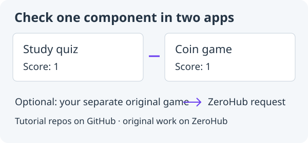

# 10. Practise sharing a component

**First checkpoint: keep your component working, then prepare a clearly labelled practice contribution.**



Reopen the **Coin game** from lesson 9. There is no lesson 10 download or new tutorial project. Keep practising in this folder. This lesson shares a tiny **CreditsBadge** in a separate **Tutorial practice** area. Copies are expected: you are learning the workflow, not claiming to have invented a new utility. PlayerInput stays in your game; you do not submit it.

Previous: [Refactor a busy Main](10-components.md).

## 1. Retain the displayed value

In `ScoreDisplay.java`, keep the private Label and Element view from lesson 9.
Find `private final Label label = new Label("Score: 0");` inside the class. Add these two fields immediately below that line (above `setScore`):

```java
private String caption = "Score";
private int points;
```

The game Main still owns the real score and when it changes. These fields remember only
what this display was last told to show. Find the existing `setScore` method, which contains `label.setText("Score: " + points);`. Replace the entire method, from `public void setScore(int points) {` through its closing `}`, with both methods below. Keep the following `view()` method:

```java
public void setScore(int points) {
    this.points = points;
    refresh();
}

private void refresh() {
    label.setText(caption + ": " + points);
}
```

`this.points` is the display's field; the parameter points is the value supplied
by the calling class. One refresh method keeps formatting in one place.

## 2. Add a caption method

In `ScoreDisplay.java`, find the closing brace of `refresh()`, immediately before `public Element view()`. Add this method between them, still inside the class:

```java
public void setCaption(String caption) {
    if (caption == null) {
        throw new IllegalArgumentException("Score caption must not be null.");
    }
    this.caption = caption;
    refresh();
}
```

Changing the caption refreshes the existing label without losing its displayed
points. The null check runs before either field changes, so a bad argument gives
a useful error and leaves the previous caption and value intact. No Zero core
change or access to the private Label is needed.

In the game's Main `setup()`, immediately after `score = new ScoreDisplay();`,
add `score.setCaption("Score");`. Keep the scoring rules and setScore calls in Main.

## 3. Run the game and check the component

Try `score.setCaption("Coins")` in setup. Run App and collect a coin; the display
should read `Coins: 1`. Finish and restart the game twice. Change the setup
caption back to `Score`. To check changing a caption **after** a value, temporarily add `score.setCaption("Coins");`
immediately after the existing `score.setScore(points);` inside the game's
coin-collection block. Collect one coin: the display should show `Coins: 1`,
proving the caption change kept that value. Stay on the coin and check it still
shows 1.

Remove that experimental line and **restore `score.setCaption("Score")` in the
game's Main `setup()` before continuing**. Keep view() and setScore(int) as the
public ways to mount and update the display.

## 4. Optionally improve PlayerInput with WASD

The game now has one place to improve keyboard input. As an optional feature,
let A/D and W/S work alongside the arrow keys. In the game's `PlayerInput.java`,
find `public int horizontal()` after the constructor and `public int vertical()` immediately after it. Replace both complete methods, from `horizontal()` through the closing brace of `vertical()`, with the following. Keep the final class brace:

```java
public int horizontal() {
    int direction = 0;
    if (game.keyDown(Key.LEFT) || game.keyDown(Key.A)) direction--;
    if (game.keyDown(Key.RIGHT) || game.keyDown(Key.D)) direction++;
    return direction;
}

public int vertical() {
    int direction = 0;
    if (game.keyDown(Key.UP) || game.keyDown(Key.W)) direction--;
    if (game.keyDown(Key.DOWN) || game.keyDown(Key.S)) direction++;
    return direction;
}
```

`||` means “or.” Right + D contributes +1 once, rather than +2. Left or A
opposes Right or D, so A + Right cancels just as Left + Right does. Main still
asks for two directions; Player still owns movement. Keep the constructor and
`GameApp game` field from lesson 9. No Zero framework change is needed.

Run App and check all arrows still work, each WASD direction, W + D diagonally,
Right + D at the same speed as Right, A + Right cancelling horizontal motion,
and W + Down cancelling vertical motion. Try both opposing arrows too. Preserve
Player's existing diagonal speed rule. Release all keys, switch windows while
holding a key, return and click the canvas, and test Restart during play and after
winning. Input should clear on focus loss and Restart; all three coins, scoring
and reset behaviour should still work. Update Main's drawn help text to
`Click the canvas, then hold arrows or WASD.` so the player can discover the keys.

## 5. Record the API and save your tested changes

Record what you checked in README, including the expected result and what you
observed. Record this API in a comment: `view()` gives the calling class an
Element; `setScore(int)` displays the supplied score; `setCaption(String)` changes
the caption while retaining that displayed value. Existing `new ScoreDisplay()`
calls still work, as do view() and setScore(int); this is a compatible improvement.
A separate instance can use a different caption without changing this one. When
you reuse the class in another project, test that caller too.

After adding the badge in the next steps, compare your [game Main](../../teaching/checkpoints/11/game/Main.java)
and [ScoreDisplay.java](../../teaching/checkpoints/11/game/ScoreDisplay.java) with
checkpoint 11 (shown before library extraction). Its [PlayerInput.java](../../teaching/checkpoints/11/game/PlayerInput.java)
includes the optional WASD change; checkpoint 10 is the arrow-only comparison if
you skipped it. Checkpoint 12 carries that same WASD helper forward.

Save your tested changes through the normal reviewed **Commit & push** and
**Merge to main** workflow for your tutorial repository. A useful method, clear
error and unchanged caller matter more than making a large library.

## 6. Add a harmless practice badge

In the Coin game's `src/main/java/`, create `CreditsBadge.java`:

```java
import zero.ui.Label;

/** Tutorial practice: copies are expected, not original community utilities. */
public class CreditsBadge {
    private final String message;

    public CreditsBadge(String message) {
        if (message == null) {
            throw new IllegalArgumentException("Badge message must not be null.");
        }
        this.message = message;
    }

    public String text() {
        return "Made with Zero: " + message;
    }

    public Label view() {
        return new Label(text());
    }
}
```

This class formats a message and creates a small Zero label. It does not read
input, move the player, change scores or run a timer. Each call to `view()` creates
its own label, so two places can display a badge without sharing a UI parent.

In the game’s `Main.java`, add `import zero.ui.Column;` alongside the other imports at the top. In `setup()`, find `message = new Label("");` and add this line immediately below it, before the Restart button is created:

```java
var badge = new CreditsBadge("Coin game");
```

Still in `setup()`, find `controls(new Row(12, score.view(), message, restartButton));`. Replace that entire call with:

```java
controls(new Column(8,
        new Row(12, score.view(), message, restartButton), badge.view()));
```

Run App. You should see `Made with Zero: Coin game` under the controls. Change the
message, run again, then restore `Coin game` for the checkpoint comparison. Check
movement, coins, win and Restart still work. The badge has no game-state job.

## 7. Extract the practice library

Keep this same tutorial repository. In **Libraries and games → Extract library**,
select **only CreditsBadge.java**, choose **UI component**, and use the
exact library name **`tutorial-credits-badge`**, version **`0.1.0`**. Give it the
title **Tutorial practice: CreditsBadge** and a short description saying it is
from this lesson. Retain the supplied MIT licence and credit Zero's tutorial.

Review the preview: CreditsBadge moves into
`libraries/tutorial-credits-badge/src/main/java/`, its package gains your numeric
repository ID, and Main imports that package. Zero updates the build source roots.
Keep Main, PlayerInput, Player, Coin and ScoreDisplay in the game. Accept the
reviewed extraction, Run App again, and check the badge and game still work.

The reserved library name is the practice marker. Keep it unchanged; using an
ordinary library name would place a copied exercise in the wrong category. There
is one practice library identity per repository. Later versions update that
entry; they do not create a new library for each attempt. Accepted version bytes
remain unchanged, so a later submitted revision uses a new exact version.

## 8. Check the library

Extraction creates deliberately failing check/example placeholders. Replace them
with the small practice sources below, retaining each filename:

- [LibraryCheck.java](../../teaching/checkpoints/11/practice/LibraryCheck.java) goes in
  `libraries/tutorial-credits-badge/src/test/java/`.
- [FirstExample.java](../../teaching/checkpoints/11/practice/FirstExample.java) goes in
  `libraries/tutorial-credits-badge/examples/first/`.
- [SecondExample.java](../../teaching/checkpoints/11/practice/SecondExample.java) goes in
  `libraries/tutorial-credits-badge/examples/second/`.

**Replace the import in all three files with the exact CreditsBadge import that
extraction added to your Main.** The reference uses a made-up repository ID;
your own package will differ. Do not copy Zero framework source into the library.

Choose **Check library → Tutorial practice: CreditsBadge**. The checks verify
independent messages, correct label text, a fresh view for each mounting and a
useful null-message error. The two finite examples use different caller messages.
They compile separately against the actual library JAR. This is a local result,
not a public listing or browser acceptance. Record the checked version and result
in the generated library README, replacing its placeholder instructions.

For browser use, export and try the Coin game using Zero's supported WebFX path.
Confirm the badge, controls, movement and Restart in the browser. A successful
compile and an actual working page are different checks. Keep publication an
explicit separate action; local browser preview is enough to practise checking.

## 9. Practise submitting and using a classmate's badge

The hosted library service must be enabled by your teacher/maintainers before a
submission can be accepted. **Library publication is currently paused.** While
it is paused, finish extraction and Check locally, save the README, and prepare
the submission; an opened form is not a listing. Do not rename the badge or use
the ordinary community path to bypass that state.

When practice sharing is enabled, use your own GitHub account and this same
public tutorial repository. Save the reviewed changes through the normal
**Commit & push** and **Merge to main** workflow. Choose **Share library**, select
the practice badge, review its exact committed folder/version and submit the
prefilled official GitHub form. Requests are public; keep private information
out of the source and metadata. The usual ownership, licence, source and library
checks still apply. Practice does not skip checking.

Find accepted badges in [ZeroHub → Tutorial practice](https://zero.codepet.ca/hub?kind=practice).
They are labelled tutorial copies and excluded from ordinary Projects/Libraries
search. Everyone is expected to have a similar badge. Completing the workflow is
the achievement; these are not candidates for automatic inclusion in Zero.

To try a classmate's accepted version, choose **Libraries and games → Browse
tutorial practice** in Zero, select their badge, deliberately choose a version if offered, and **Add library → Apply**.
Use the exact import shown for their package. In Main, replace only the badge
construction with their fully qualified class name and the same message argument;
keep your own library in local mode and keep the game rules unchanged. Run App
and check the displayed message. Use a new exact version for an improvement and
review Update/Revert deliberately; editor updates never replace it automatically.

Teachers/maintainers may periodically clear practice listings. That removes them
from practice discovery. Your GitHub source, local extracted source and already
added JARs are not deleted. Keep your project and its version records. Re-fetching
or checking a withdrawn dependency follows Zero's normal availability rules;
clearing the gallery is not a promise that every later dependency operation will
succeed. Coursework repository links still go separately to Pika.

## 10. Optional extension: contribute an original idea

After practising the workflow, look for a capability your own app actually needs:
a configurable input mapping, a useful animation helper or another component you
can explain. Keep PlayerInput and copied CreditsBadge out of the ordinary
community catalogue. Build an original or meaningfully adapted component in an
original project you own, outside `zero.*`, and credit sources and licences.
This extension is optional; it is not a required fourth tutorial project.

Document its public methods and ownership, meaningful behaviour checks and two
small consumers. Run Check library and record the exact source/version. For
browser consumers, also export through WebFX and try the relevant behaviour.
Use the ordinary community sharing flow only when hosted acceptance is enabled.

Once the component has helped more than one app, you may propose the proven idea
for Zero itself. Include the problem, proposed API, source/version and contributor
credit, native/browser evidence, README and licence, and how existing callers
would keep working or migrate. A proposal can start in README without publication.
Maintainers may adopt or adapt it, keep it as a community library, or defer it.
A practice submission, listing or popularity never promotes code automatically.
Existing project versions stay unchanged until users deliberately upgrade.

Continue growing your **same Coin game** with media in [lesson 11](12-media.md).
