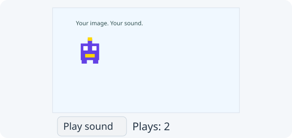

# 12. Add artwork and sound

**First checkpoint: your moving player becomes a sprite and a collected coin rings.**



Reopen the **same Coin game** you wrote in lessons 8–11. Keep your Player, Coin, PlayerInput, ScoreDisplay and Main. This lesson changes your current project in place and supplies no later stage project ZIPs. Optionally download the small [game assets ZIP](https://zero.codepet.ca/generated/learning-assets/game-assets.zip) and place `media-demo/player.png` and `media-demo/chime.wav` under `src/main/resources/`. You may use your own PNG and short WAV at those paths, or use the drawing route below without assets.

Previous: [Improve and propose a component](11-zerohub.md).

## 1. Draw an image from Player

Add `import zero.ImageRegion;` to your existing Player. Keep its shape-drawing
method for the drawing route, and add:

```java
public void drawImage(GameApp app, ImageRegion sprite) {
    app.image(sprite, x, y, size, size);
}
```

An ImageRegion describes a rectangle in shared image pixels. This lesson loads
the whole image, then draws it at Player's existing position and size. There is
still one Player, with the same movement and collision rules.

## 2. Add fields to Main

Import `zero.ImageRegion`, `zero.Sound` and `zero.ui.Column`. Keep the existing
Zero Label, Button and Row imports. Add:

```java
private ImageRegion sprite;
private Sound chime;
private Label soundStatus;
private Label assetStatus;
private int plays;
```

## 3. Add an explicit artwork action

Add this method to Main:

```java
public void loadAssets() {
    try {
        ImageRegion nextSprite = loadImageRegion("/media-demo/player.png");
        Sound nextChime = loadSound("/media-demo/chime.wav");
        nextChime.setVolume(0.25);
        sprite = nextSprite;
        chime = nextChime;
        assetStatus.setText("Artwork and sound ready");
    } catch (IllegalArgumentException failure) {
        assetStatus.setText(failure.getMessage());
    }
    showGame();
}
```

The `/` starts at `src/main/resources/`. Load both candidates before changing the
fields. If a requested file is missing or invalid, the error names its path and
the existing game stays playable. The catch handles this expected resource error
and shows it; it does not silently ignore it. Other programming errors still surface.
`showGame()` returns keyboard focus to the retained canvas after the button.

Zero caches the image pixels and owns the Sound's cleanup when the app closes.
A repeated load may create a new immutable ImageRegion over the same cached
pixels. Restart reuses these resources; do not close the borrowed Sound there.
Load in setup or an action, never every frame. Use artwork/audio you created or
have permission to redistribute, and include required licence files in the
project. These are bundled paths, not absolute paths on your computer.

In browsers, packaged images preload before setup. A corrupt packaged PNG can
therefore report a startup error before the button appears. Audio may fail later
during decoding or playback; keep Zero's named audio notices and gesture prompt.
The ready label means the action selected resources, not that sound was heard.

## 4. Add controls once in setup

Replace the existing `controls(new Row(...))` call with:

```java
soundStatus = new Label("");
assetStatus = new Label("Drawing mode");
var artworkButton = new Button("Use artwork and sound");
artworkButton.onClick(() -> loadAssets());
controls(new Column(8,
        new Row(12, score.view(), soundStatus, message, restartButton),
        new Row(12, artworkButton, assetStatus)));
```

Keep the existing score, message, Restart callback and final `restart()` call.
The second row gives the action and its result room below the score. The game
starts in drawing mode, even when resources are bundled.

At the start of `restart()`, add `if (chime != null) chime.stop();`. After resetting
points, reset the request counter:

```java
plays = 0;
soundStatus.setText("Chimes: 0");
```

## 5. Request a chime after collection

Inside the existing coin-collection block, immediately after
`score.setScore(points);`, add:

```java
if (chime != null) {
    chime.stop();
    chime.play();
    plays++;
    soundStatus.setText("Chimes: " + plays);
}
```

Main's collected check still prevents repeated scoring and sound requests while
standing on one coin. The counter records requests; your ears, device volume
and media support determine whether you hear the sound.

## 6. Choose the image or drawing

At the end of Main's existing draw method, replace `player.draw(this);` with:

```java
if (sprite == null) player.draw(this);
else player.drawImage(this, sprite);
```

## 7. Run both routes and test Restart

Run App before importing assets. The blue square can collect all three coins and
Restart. Click **Use artwork and sound**: a missing path should appear, and you
can still play. If you choose a drawing-only game, keep drawing and remove the
artwork button and media fields from your finished version.

For the artwork route, import the two files at the paths above, run again and
click the button. The player becomes the supplied image. Collect one coin and
stay there: score and chime count rise once. Finish and Restart twice. Score and
chime count return to 0; the artwork stays loaded. Repeated artwork clicks reuse
resources and keep the same Player and control objects. If playback is blocked,
follow the browser's click/key prompt. Check actual sound separately from the
counter. Compare your [Main.java](../../teaching/checkpoints/12/media/Main.java)
and [Player.java](../../teaching/checkpoints/12/media/Player.java) after writing
your code. The API reference describes additional image and sound methods.

## 8. Optional stage 2: scroll a wider world

Keep editing this folder. Add a new `Camera.java` class with a private `double x`, `double x()` getter, and this method:

```java
public void follow(double playerX, double viewportWidth, double worldWidth) {
    x = Math.max(0, Math.min(playerX - viewportWidth / 2,
            worldWidth - viewportWidth));
}
```

Add `public double x() { return x; }` to Player. In Main add `private final double worldWidth = 1600;` and `private Camera camera;`. Create `camera = new Camera();` in `restart()` and move two coins farther away, for example x 840 and 1360. Pass `worldWidth` instead of `width()` to `player.update(...)`, then call `camera.follow(player.x(), width(), worldWidth);` after movement. To draw world objects, add overloads `Player.draw(GameApp app, double cameraX)`, `Player.drawImage(GameApp app, ImageRegion sprite, double cameraX)` and `Coin.draw(GameApp app, double cameraX)`. In each, use `x - cameraX` for the image or rectangle's horizontal drawing coordinate; keep the original methods and collection positions unchanged. In Main's `draw()`, pass `camera.x()` to those new methods. Zero ScoreDisplay and Restart stay outside the canvas and do not scroll. Check both world edges and collect a far coin. Compare your edits with the optional [scrolling checkpoint Main](../../teaching/checkpoints/12/scrolling/Main.java) and [Camera.java](../../teaching/checkpoints/12/scrolling/Camera.java), then return to **your own code**. Keep the PlayerInput helper from lessons 10–11; it still supplies horizontal and vertical directions, while Main owns the update and camera calls.

## 9. Choose one next improvement

Finish by testing your same small Coin game: collect each coin once, win,
Restart, and play again. Check the drawing fallback and any assets you chose.
If you added scrolling, check both world edges and the fixed HUD. Keep your
PlayerInput and ScoreDisplay responsibilities separate from Main’s game rules.

Choose one small improvement of your own: change the controls, add a score
caption, or write clearer instructions. Use the refactor → test → improve →
proposal process from [lesson 10](10-components.md) and
[lesson 11](11-zerohub.md). A larger platformer, enemy system or level manager
can be a later original project; you do not need one to complete this tutorial.

Return to the [lesson index](README.md).
