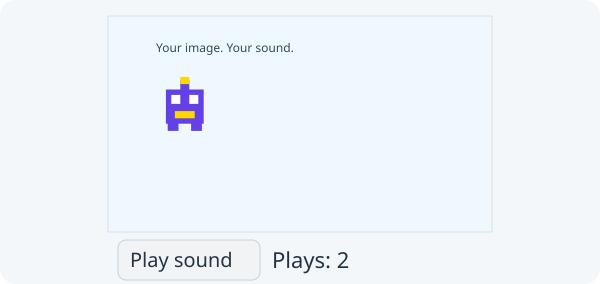

# 12. Add artwork and sound

Continue the same Coin repository from [lesson 11](11-zerohub.md).

## 1. Start an artwork and sound branch

Start from the tested **main** at the end of lesson 11. In the **Project**
panel, click **main**, then choose:

**New branch…**

Enter `coin-media` and press Enter. Check that `coin-media` is selected.

## 2. Choose your assets

Use your own artwork and sound, or download and unzip the optional [game assets ZIP](https://zero.codepet.ca/generated/learning-assets/game-assets.zip), which includes `player.png` and `chime.wav`. Use artwork and audio you created or have permission to redistribute, and include any required licence information.

In Zero's Project Explorer, right-click **resources** and choose:

**New folder…**

Name the folder `media-demo`. Right-click **media-demo** and choose:

**Import assets…**

Select the image you want from the unzipped folder. You will import the
sound in step 4.

## 3. Add and test the artwork

Decide where to load and draw your image. Use [Show your pet](13-pet.md) as a
reference. Run the game. Move the player, collect a coin and try Restart.
Check that the artwork stays visible and that you can still read the score.

Save your files on `coin-media`, enter `Add Coin game artwork`, and choose:

**Commit**

## 4. Add and test the collection sound

Right-click **media-demo**, choose **Import assets…**, and select the sound.
Use [Animate your pet](16-pet-motion.md) as a reference for loading and playing
it. Play it where the game awards a point for a newly collected coin.
Run and stay on a collected coin. Check that it scores and plays the sound
once. Win, then Restart and play again. Keep the game understandable
with the sound muted.

Save your files, enter `Play a sound when a coin is collected`, and choose:

**Commit**

## 5. Sync, merge and test on main

Stop the game. With `coin-media` selected, choose:

**Sync**

Wait for Sync to finish. Choose **Merge** beside the branch name and confirm
**Merge coin-media into main?**

Confirm **main** is selected. Run the merged game, collect a coin and try
Restart. Check that both the artwork and sound still work.

Stop the game. In the Command Palette, choose **Zero: Export for Web**, then
choose **Preview export** in Zero. Collect a coin in the browser and check
the artwork, sound and Restart.

## 6. Publish the tested game

Stop the app and open the Run dropdown, then choose:

**Publish & open app**

Follow the prompts, then check the artwork, sound, scoring and Restart in the
published app.

Return to the [lesson index](README.md).
