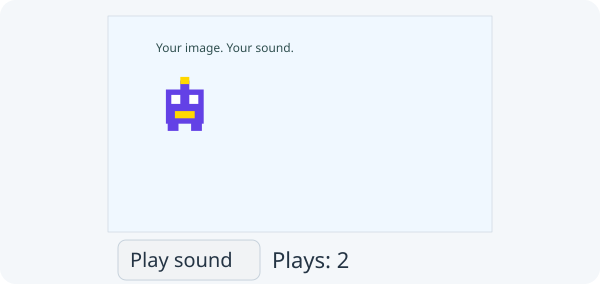

# 12. Add artwork and sound

Continue the same Coin repository from [lesson 11](11-zerohub.md).

## 1. Choose your assets

Use your own artwork and sound, or download and unzip the optional [game assets ZIP](https://zero.codepet.ca/generated/learning-assets/game-assets.zip), which includes `player.png` and `chime.wav`. Use artwork and audio you created or have permission to redistribute, and include any required licence information.

In Zero's Project Explorer, right-click **resources** and choose:

**New folder…**

Name the folder `media-demo`. Right-click **media-demo** and choose:

**Import assets…**

Select the files you want from the unzipped folder.

## 2. Make the game yours

Decide where to load an image and sound, how to draw the image, and when to play the sound. Revisit [Show your pet](13-pet.md) and [Animate your pet](16-pet-motion.md) for examples of loading and using assets. Adapt those ideas to your own Coin game; keep its movement, scoring and Restart working. Make the game understandable without sound, and consider whether your artwork and text are easy to see.

## 3. Test and share

Run and collect a coin while staying on it: it should score once, and any collection sound should play once. Win, Restart and play again. Check your chosen artwork and listen for your sound. Test in the browser too, following any browser prompt needed to enable audio. When you are ready, choose **Commit & push** to save your work to your repository. To publish, stop the app and choose **Publish & open app** from the Run dropdown. Follow the prompts, then test the published app.

Return to the [lesson index](README.md).
