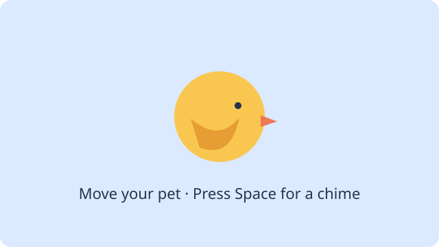

# 13. Make a pet game



Make a bird pet that flaps, moves, and chimes, then give it its own `Pet` class. Start the Pet tutorial in Zero. If its starter is unavailable, ask your teacher for the verified Pet template; do not clone Zero’s shared template as your own project.

## 1. Start your own project

In Zero choose **Start tutorial → Animated pet**, sign in, name your project and choose a clone location. Zero creates your own repository and opens its clone. If your teacher provides the verified matching template link, you can instead use **Use this template** on GitHub, then choose **Project → Clone** in Zero and clone your own repository. Open that clone, not the shared template repository. After setup, editing and local Run work offline; GitHub actions and publishing need a connection. Submit your repository link separately in Pika if your teacher asks.

Download the [Pet assets ZIP](https://zero.codepet.ca/generated/learning-assets/pet-assets.zip) and unzip it. In Zero's file tree, right-click **resources**, choose **New folder…** and name it `pet`. Right-click the new **pet** folder, choose **New asset…**, and select both files from the unzipped `pet` folder. The imported files belong in `src/main/resources/pet/` and must be named `bird-flap-sheet.png` and `chime.wav`. The leading `/` in `/pet/bird-flap-sheet.png` means the root of the project's resources, not your computer. The bird and chime are Zero assets supplied under the project license. For your own replacements, use a PNG and a short PCM WAV and retain permission and attribution.

Start on **main**. The checkpoints here are complete reference files: type the changes yourself, or compare them when stuck. Java files go in `src/main/java/`, not `resources`. Save and **Run App** after each step; stop the app before changing and running again.

## 2. Show your pet

Write this in your project’s `Main.java`: `settings` sets canvas size, `setup` loads the picture once, and `draw` paints the background and picture each frame. `280, 150` is the top-left position; `80, 64` is its drawn size. The sheet has four poses; `imageRegion` selects the first pose. Run: you should see a bird. Try another background color or size. If the resource cannot load, check spelling, capitalization and the resource folder, then stop and run again.

```java
import zero.Color;
import zero.GameApp;
import zero.ImageRegion;

public class Main extends GameApp {
    private ImageRegion petImage;

    @Override public void settings() { size(640, 400); }
    @Override public void setup() {
        var sheet = loadImageRegion("/pet/bird-flap-sheet.png");
        petImage = imageRegion(sheet.image(), 0, 0, 701, 561);
    }

    @Override public void draw() {
        background(Color.rgb(240, 248, 255));
        image(petImage, 280, 150, 80, 64);
    }

    public static void main(String[] args) { launch(args); }
}
```

## 3. Move, animate and make sound

Replace `Main.java` with the version below, then read and try each change:

1. Find `x` in the field and `image` call. In `update`, left and right change `x`. Multiplying by `seconds` makes speed depend on elapsed time, not the number of frames. The `Math.max`/`Math.min` line keeps the 80-pixel pet inside the canvas. After running, click the canvas and hold the arrows.
2. In `setup`, the sheet loads once and four `ImageRegion` frames describe its poses. Each region selects a 701 × 561 rectangle from the same picture; the lower poses begin at y = 531 to compensate for the artwork’s offset. `SpriteAnimation(8, frames)` sets eight frames per second. `petAnimation.update(seconds)` advances it once in `update`; `image` draws its current frame without advancing it. Watch the wings flap; then try a different frame rate.
3. Find where the chime loads once in `setup`. In `update`, `keyPressed` fires on a new press, while `keyDown` stays true while held. Stop and play the chime on a Space press. Click the canvas and press Space. Browser sound may need a user gesture and the device must not be muted.

```java
import zero.Color;
import zero.GameApp;
import zero.ImageRegion;
import zero.Key;
import zero.Sound;
import zero.SpriteAnimation;

public class Main extends GameApp {
    private SpriteAnimation petAnimation;
    private Sound chime;
    private double x = 280;

    @Override public void settings() { size(640, 400); }
    @Override public void setup() {
        var sheet = loadImageRegion("/pet/bird-flap-sheet.png");
        ImageRegion[] frames = {
            imageRegion(sheet.image(), 0, 0, 701, 561),
            imageRegion(sheet.image(), 701, 0, 701, 561),
            imageRegion(sheet.image(), 0, 531, 701, 561),
            imageRegion(sheet.image(), 701, 531, 701, 561)
        };
        petAnimation = new SpriteAnimation(8, frames);
        chime = loadSound("/pet/chime.wav");
        chime.setVolume(0.25);
    }

    @Override public void update(double seconds) {
        if (keyDown(Key.LEFT)) x -= 160 * seconds;
        if (keyDown(Key.RIGHT)) x += 160 * seconds;
        x = Math.max(0, Math.min(x, width() - 80));
        petAnimation.update(seconds);
        if (keyPressed(Key.SPACE)) {
            chime.stop();
            chime.play();
        }
    }

    @Override public void draw() {
        background(Color.rgb(240, 248, 255));
        fill(Color.rgb(47, 79, 79));
        textSize(20);
        text("Click the canvas; arrows move, Space chimes.", 20, 30);
        image(petAnimation, x, 150, 80, 64);
    }

    public static void main(String[] args) { launch(args); }
}
```

Compare with the [movement checkpoint](../../teaching/checkpoints/13/2/Main.java).

## 4. Save the first working version and make a branch

With the working game on **main**, choose **Commit & push**. Review the files including the Java source and both assets, enter a useful message, and confirm. Check your repository on GitHub to see that main contains these files. Then choose **New branch** in the repository menu and name it `pet-refactor`. This creates a local branch for your next change.

## 5. Give the pet its own class

`Main` now knows the pet's position and animation as well as input and sound. Create `Pet.java` beside `Main.java` and write the first class below. Then replace Main with the second class. A class describes a kind of object; `new Pet(new SpriteAnimation(8, frames))` creates one pet and gives it an animation. The constructor saves that animation. The position `x` and animation clock belong to that pet. Its `update` changes those fields, and `draw` uses them to paint the pet.

Update `Main.java` to match `3/Main.java`: replace the old animation and `x` fields with `Pet pet`; create it in `setup`; pass a direction, elapsed seconds and width to `pet.update`; and call `pet.draw(this)`. `this` is the running game that supplies drawing methods. Main still handles input and sound and calls the pet's update **once** per frame. Both arrows held together produce direction 0. Run again: the image, flapping, movement and Space sound should behave as before. Explain which data belongs to the pet and why Main no longer needs the animation update details. Try changing the speed in `Pet`.

```java
import zero.GameApp;
import zero.SpriteAnimation;

// One pet owns its position and animation clock.
public class Pet {
    private final SpriteAnimation animation;
    private double x = 280;

    public Pet(SpriteAnimation animation) { this.animation = animation; }

    public void update(int direction, double seconds, double canvasWidth) {
        x += direction * 160 * seconds;
        x = Math.max(0, Math.min(x, canvasWidth - 80));
        animation.update(seconds);
    }

    public void draw(GameApp game) {
        game.image(animation, x, 150, 80, 64);
    }
}
```

```java
import zero.Color;
import zero.GameApp;
import zero.ImageRegion;
import zero.Key;
import zero.Sound;
import zero.SpriteAnimation;

public class Main extends GameApp {
    private Pet pet;
    private Sound chime;

    @Override public void settings() { size(640, 400); }
    @Override public void setup() {
        var sheet = loadImageRegion("/pet/bird-flap-sheet.png");
        ImageRegion[] frames = {
            imageRegion(sheet.image(), 0, 0, 701, 561),
            imageRegion(sheet.image(), 701, 0, 701, 561),
            imageRegion(sheet.image(), 0, 531, 701, 561),
            imageRegion(sheet.image(), 701, 531, 701, 561)
        };
        pet = new Pet(new SpriteAnimation(8, frames));
        chime = loadSound("/pet/chime.wav");
        chime.setVolume(0.25);
    }

    @Override public void update(double seconds) {
        int direction = 0;
        if (keyDown(Key.LEFT)) direction--;
        if (keyDown(Key.RIGHT)) direction++;
        pet.update(direction, seconds, width());
        if (keyPressed(Key.SPACE)) {
            chime.stop();
            chime.play();
        }
    }

    @Override public void draw() {
        background(Color.rgb(240, 248, 255));
        fill(Color.rgb(47, 79, 79));
        textSize(20);
        text("Click the canvas; arrows move, Space chimes.", 20, 30);
        pet.draw(this);
    }

    public static void main(String[] args) { launch(args); }
}
```

Compare with [Pet.java](../../teaching/checkpoints/13/3/Pet.java) and [Main.java](../../teaching/checkpoints/13/3/Main.java).

## 6. Save and share deliberately

Run and check your game, then choose **Commit & push**, review the branch and changed files, enter a useful message, and confirm. This sends your branch to your repository. Commit & push remaining edits before **Merge to main**. Merge to main merges the current branch into main and pushes main; it does not create a pull request. If Zero brings in newer main code, Run App again, resolve reported conflicts carefully, and choose Merge to main again. Never discard work just to make a merge succeed.

To publish, stop the game, ensure the intended main version is committed and pushed, then use the Run dropdown's **Publish & open app** (or **Publish app** in an older released Zero). Review the account, repository, visibility and GitHub Pages prompts before confirming. Publishing makes the app available at its public URL; wait for success and open the link on another browser/device. If the command is unavailable or a build fails, keep your source and ask your teacher; do not assume a public page exists. Local edits after publishing are not automatically the published version.

## 7. Practise recovering your project

First verify on GitHub that the merged main contains all your Java files and both assets, and check the published app actually opens and works. Review the changes and push status in Zero for uncommitted, untracked or unpushed work. Also look through the project folder for files Git ignores: they may not appear in the change list. Commit and push what belongs in your repository, and copy any private or ignored files you need to a separate safe backup. Confirm that backup opens. GitHub cannot restore files you never uploaded.

Close the project. Move the original project folder to your computer’s Trash; **do not empty the Trash**. It remains recoverable there (unless your system automatically empties it), and you should retain another backup. Now use **Project → Clone** to clone your own repository into a different empty location. Open the new clone and Run App. Confirm picture, flapping, movement and chime. If anything is missing or the clone fails, restore the original folder from Trash or your backup; do not overwrite either copy. A future rebuild may need pinned tools and dependency hosts; keep a copy of your source and finished web output too.
