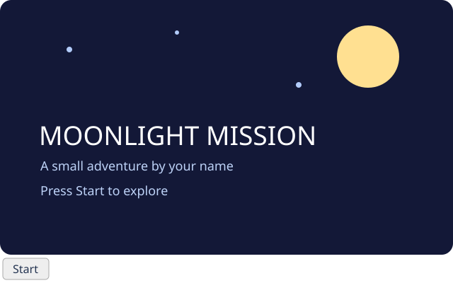

# 9. Add a welcome screen



Continue the same Pet project and `pet-refactor` branch from [lesson 8](17-pet-class.md); keep both `java/Main.java` and `java/Pet.java`. These changes start from the lesson 8 checkpoint. If you changed it, adapt the matching lines to your version.

## 1. Import Button

In `Main.java`, add the import after the existing imports. Copy each block over its matching lines; highlighted additions are part of the copied code.

```java-after-2
import zero.SpriteAnimation;
import zero.ui.Button;
```

## 2. Remember the current scene

Add two fields beside the existing fields. `playing` starts false, so the welcome screen appears first.

```java-after-3-4
    private Pet pet;
    private Sound chime;
    private boolean playing = false;
    private Button navigation;
```

## 3. Create the navigation button

At the end of `setup()`, create a button in the controls area and give it an action:

```java-after-2-3-4
        chime.setVolume(0.25);
        navigation = new Button("Start");
        navigation.onClick(this::switchScreen);
        controls(navigation);
    }
```

## 4. Switch between scenes

Add this method after `setup()`. Each click changes the scene and the button label.

```java-after-4-5-6-7
        controls(navigation);
    }

    private void switchScreen() {
        playing = !playing;
        navigation.setText(playing ? "Back" : "Start");
    }
```

## 5. Pause the game on the welcome screen

At the start of `update`, return while the welcome screen is showing. The existing input, pet animation and sound code stays below it. The same `Pet` object keeps its position when you return.

```java-after-2
    @Override public void update(double seconds) {
        if (!playing) return;
```

## 6. Draw each scene

Replace the matching start of `draw` with this block. Keep the existing background, instructions and `pet.draw(this)` below it; those lines draw the game scene when `playing` is true.

```java-after-2-3-4-5-6-7-8-9-10-11-12
    @Override public void draw() {
        if (!playing) {
            background(Color.rgb(19, 24, 55));
            fill(Color.rgb(255, 224, 145));
            circle(520, 70, 70);
            fill(Color.WHITE);
            textSize(38);
            text("MY PET GAME", 55, 205);
            textSize(18);
            text("Press Start to meet your pet", 57, 242);
            return;
        }
        background(Color.rgb(240, 248, 255));
```

## 7. Test both scenes

Save and choose **Run**. Click **Start**, click the canvas and use the arrows and Space. Click **Back**, then **Start** again: the pet should resume from its saved position. The button stays in the controls area while the canvas changes. Change the welcome title, colours or shapes to make it yours, then check both scenes again.

## 8. Save your branch

Review your code and README for private information before sharing publicly. Run and check your game. In the Zero sidebar, choose:

**Commit & push**

Review the branch and changed files, enter a useful message, and confirm. This sends your branch to your repository.

## 9. Merge your work

After committing and pushing any remaining edits, choose:

**Merge to main**

Zero merges the current branch into main and pushes main; it does not create a pull request. If Zero brings in newer main code, choose **Run** again, resolve reported conflicts carefully, and choose **Merge to main** again. Never discard work just to make a merge succeed. Submit your repository link separately in Pika if assigned.

## 10. Publish your game

Stop the game and ensure the intended main version is committed and pushed. Open the dropdown next to **Run**, then choose:

**Publish & open app**

An older released Zero may call this **Publish app**. Review the account, repository, visibility and GitHub Pages prompts before confirming. Publishing makes the app available at its public URL. Wait for success and open the link on another browser or device. Test Start, Back, movement and sound. If the command is unavailable or a build fails, keep your source and check the publishing guidance; do not assume a public page exists. Local edits after publishing are not automatically the published version.

## 11. Back up your project

First verify on GitHub that the merged main contains both Java files and both assets, and check the published app actually opens and works. Review the changes and push status in Zero for uncommitted, untracked or unpushed work. Also look through the project folder for files Git ignores: they may not appear in the change list. Commit and push what belongs in your repository, and copy any private or ignored files you need to a separate safe backup. Confirm that backup opens. GitHub cannot restore files you never uploaded.

## 12. Practise recovering your project

Close the project. Move the original project folder to your computer’s Trash; **do not empty the Trash**. It remains recoverable there (unless your system automatically empties it), and you should retain another backup. On the Zero Start Page, choose:

**Project → Clone**

Clone your own repository into a different empty location. Open the new clone and choose **Run**. Confirm the welcome screen, Start and Back, picture, flapping, movement and chime. If anything is missing or the clone fails, restore the original folder from Trash or your backup; do not overwrite either copy. A future rebuild may need pinned tools and dependency hosts; keep a copy of your source and finished web output too.
