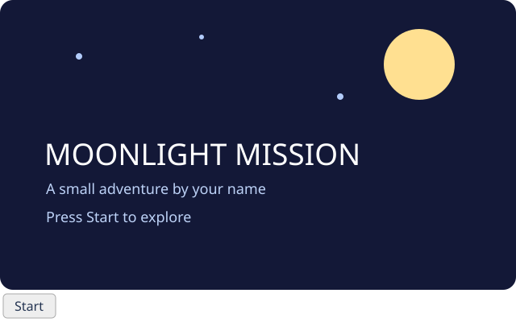

# 14. Make your own project



Create an original game project and give it a welcome screen. Your screen will have a title, a small illustration and a **Start** button. Start opens a simple game scene; **Back** returns to the title. Then make the idea yours.

## 1. Create your project

1. Complete Zero and GitHub setup, including Git name and email. Ask your teacher about what may be shared publicly. A public repository and a published app can be seen by anyone; do not put secrets or private information in them.
2. On Zero's Start Page choose **Project ▾ → New**. Sign in if asked. Give your repository a name, choose a clone location, and choose **Clone here**. Zero creates your own repository and opens its clone. If creation succeeds but cloning fails, use **Project ▾ → Clone** with your new repository URL.
3. Open `src/main/java/Main.java`. This is your project, so choose a game idea and a title. You can run locally after setup without GitHub once the needed dependencies are cached.

## 2. Make a canvas

Replace the contents of `Main.java` with the code below. Save and click **Run App**. You should see a dark canvas with a moon and a title. Stop the app before changing code and run again after each checkpoint.

```java
import zero.Color;
import zero.GameApp;

public class Main extends GameApp {
    @Override public void settings() {
        title("Moonlight Mission");
        size(640, 360);
    }

    @Override public void draw() {
        background(Color.rgb(19, 24, 55));
        fill(Color.rgb(255, 224, 145));
        circle(520, 70, 70);
        fill(Color.WHITE);
        textSize(38);
        text("MOONLIGHT MISSION", 55, 205);
    }

    public static void main(String[] args) { launch(args); }
}
```

`GameApp` calls `draw()` repeatedly. `background` clears the canvas, `fill` chooses the colour for the shapes and text that follow, and `circle(x, y, diameter)` uses a centre position. `text` uses a baseline position. `Color.rgb` takes red, green and blue values from 0 to 255.

## 3. Add a button and two scenes

Replace the whole file with the code below. Save and run. Click **Start**: the picture changes and a circle follows your pointer over the canvas. Click **Back**: the welcome screen returns. Try Start and Back again.

```java
import zero.Color;
import zero.GameApp;
import zero.ui.Button;

public class Main extends GameApp {
    private boolean playing = false;
    private Button navigation;

    @Override public void settings() {
        title("Moonlight Mission");
        size(640, 360);
    }

    @Override public void setup() {
        navigation = new Button("Start");
        navigation.onClick(this::switchScreen);
        controls(navigation);
    }

    private void switchScreen() {
        playing = !playing;
        navigation.setText(playing ? "Back" : "Start");
    }

    @Override public void draw() {
        if (playing) {
            drawGame();
        } else {
            drawTitle();
        }
    }

    private void drawTitle() {
        background(Color.rgb(19, 24, 55));
        fill(Color.rgb(56, 66, 115));
        circle(535, 80, 110);
        fill(Color.rgb(255, 224, 145));
        circle(520, 70, 70);
        fill(Color.rgb(124, 151, 207));
        circle(90, 65, 5);
        circle(170, 120, 7);
        circle(390, 45, 5);
        circle(570, 180, 7);
        fill(Color.WHITE);
        textSize(38);
        text("MOONLIGHT MISSION", 55, 205);
        fill(Color.rgb(189, 210, 247));
        textSize(18);
        text("A small adventure by your name", 57, 242);
        text("Press Start to explore", 57, 276);
    }

    private void drawGame() {
        background(Color.rgb(27, 55, 74));
        fill(Color.rgb(68, 122, 112));
        rect(0, 260, 640, 100);
        fill(Color.rgb(255, 224, 145));
        circle(500, 75, 65);
        fill(Color.WHITE);
        textSize(24);
        text("Your adventure begins here!", 35, 55);
        textSize(16);
        text("Move your pointer across the scene.", 35, 85);
        fill(Color.rgb(241, 164, 116));
        circle(mouseX(), mouseY(), 32);
    }

    public static void main(String[] args) { launch(args); }
}
```

After trying it, compare your file with the [full checkpoint](../../teaching/checkpoints/14/Main.java).

Read the changes in order:

- `playing` remembers which scene to draw. It begins as `false`.
- `setup()` creates a Zero `Button`, gives it an action and puts it in the game controls area. `this::switchScreen` means run that method when clicked.
- `switchScreen()` changes the boolean and changes the button label. The button stays in the controls area while the canvas changes.
- `draw()` chooses `drawTitle()` or `drawGame()` each frame. These are ordinary methods you own. `mouseX()` and `mouseY()` give the pointer's canvas position.

The game scene is a starting point, not a finished game. The button is a native control outside the drawn canvas, so its appearance may differ between platforms.

## 4. Make it yours

Change the window title, the large title and the author line. Pick a setting: space, ocean, forest or something else. Change RGB colours and add at least two shapes with `circle` or `rect`. Change the scene's message to explain your future game. Run again and check both scenes and both button labels. Keep text short enough to fit inside the canvas.

Try changing one number at a time: in `rect(x, y, width, height)`, the first two numbers are the upper-left position; in `circle`, the first two are its centre. If Java reports an error, check quotation marks, semicolons and matching braces, then save and run again. You can compare your file with the checkpoint.

## Optional: add a simple HUD

A HUD shows useful information while a game is running. Inside `drawGame()`,
immediately after `text("Move your pointer across the scene.", 35, 85);`, add
`text("Score: 0", 35, 120);` and run again. The existing white fill makes the
label easy to read. This first label is fixed text; later, you can create a
score field and update it when the player earns points.

## 5. Save and share

Review your code and README for private information. Use **Commit & push**, enter a useful message such as `Create welcome screen`, and confirm the action. This saves a commit and pushes your current branch to your repository. If you are working on a branch, review and use **Merge to main** when ready. Give your teacher the repository link separately in Pika as instructed.

To share a playable browser version, stop the app, commit and push the version you want, then choose **Run ▾ → Publish & open app** and follow Zero's prompts. Publishing makes the app and included assets public. Open the resulting page and test Start and Back. If your installed Zero offers **Publish app** instead, use that action and open the resulting link. Publication requires the connected GitHub/Pages setup; a local run alone does not publish anything.
