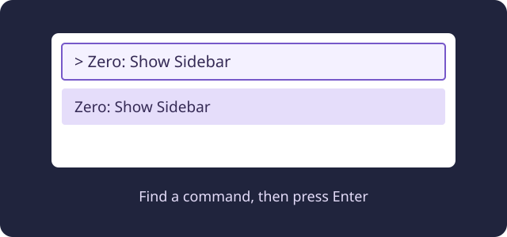

# 1. Find your way back to Zero

If a panel or page disappears, you can open it again with the Command Palette. These steps do not change your project files.

## 1. Open the Command Palette

In Zero, press **Cmd+Shift+P** on a Mac or **Ctrl+Shift+P** on Windows. A box opens near the top of the window. This is different from **Cmd+P**, which opens a file picker.

Type a command below, then select it or press Enter. If the box closes, use the shortcut again.

## 2. Practise finding things

1. Run **Zero: Show Sidebar**. The Zero controls should appear in the sidebar.
2. Run **Zero: Show Project Explorer**. The project view should appear in the sidebar, with your project files when a project is open.
3. Run **Zero: Start Page**. The Start Page should open in an editor tab.
4. Run **Zero: Tutorial docs**. The tutorial website should open beside your code, or in your regular browser. Return to this lesson from the tutorial list if you want to practise again.

You can switch between open editor tabs without closing your project. Try opening the sidebar and Start Page again to see how to get back to them.

## If no project is open

The sidebar can appear without project files. Open **Zero: Start Page**, then choose **Project ▾ → Open local project…** to select an existing local Zero project. If you do not have one yet, you can still read the tutorials; ask your teacher how to get started. Opening these pages does not require creating an account or repository.
