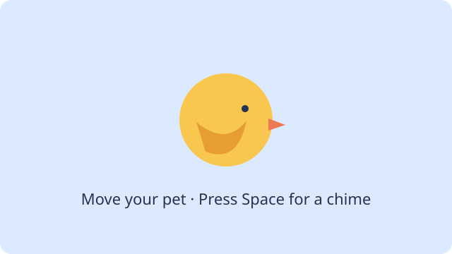

# 7. Animate your pet



Continue the same Pet project from [lesson 6](13-pet.md). Open **java → Main.java**. Your last version shows one still bird. In this lesson you will move it, make its wings flap, and play a chime. Keep the `pet` folder and both assets from the last lesson.

The code blocks below show the lines to add and remove. Replace the matching lines in your file with the copied block. Do the edits in order; keep the other code in `Main.java`.

## 1. Move the bird

Add the `Key` import below `ImageRegion`:

```java-after-2
import zero.ImageRegion;
import zero.Key;
```

Add an `x` field below `petImage`. It starts the bird at the same horizontal position as before.

```java-after-2
    private ImageRegion petImage;
    private double x = 280;
```

Add this `update` method **above** the existing `draw` method:

```java-after-1-2-3-4-5-6
    @Override public void update(double seconds) {
        if (keyDown(Key.LEFT)) x -= 160 * seconds;
        if (keyDown(Key.RIGHT)) x += 160 * seconds;
        x = Math.max(0, Math.min(x, width() - 80));
    }

    @Override public void draw() {
```

Replace the `image` line in `draw` so it uses `x` instead of the fixed number `280`:

```java-after-2-r1
        image(petImage, 280, 150, 80, 64);
        image(petImage, x, 150, 80, 64);
```

Save and **Run App**. Click the canvas, then hold the left and right arrow keys. The still bird should move and stay inside the window. Stop the app before the next edit.

`keyDown` stays true while a key is held. Zero passes the elapsed time since the last frame as `seconds`; multiplying the speed by it keeps motion approximately consistent at different frame rates. The `Math.max` and `Math.min` line keeps the 80-pixel-wide bird inside the canvas.

## 2. Make the wings flap

Add the animation import:

```java-after-2
import zero.Key;
import zero.SpriteAnimation;
```

Replace the `petImage` field with a `petAnimation` field. Keep the `x` field underneath it.

```java-after-2-r1
    private ImageRegion petImage;
    private SpriteAnimation petAnimation;
```

In `setup`, keep the `loadImage` line and replace the single `imageRegion` assignment with four frames and an animation:

```java-after-3-4-5-6-7-8-9-r2
        var sheet = loadImage("/pet/bird-flap-sheet.png");
        petImage = imageRegion(sheet, 0, 0, 701, 561);
        ImageRegion[] frames = {
            imageRegion(sheet, 0, 0, 701, 561),
            imageRegion(sheet, 701, 0, 701, 561),
            imageRegion(sheet, 0, 531, 701, 561),
            imageRegion(sheet, 701, 531, 701, 561)
        };
        petAnimation = new SpriteAnimation(8, frames);
```

In `update`, add one line after the line that keeps `x` inside the canvas:

```java-after-2
        x = Math.max(0, Math.min(x, width() - 80));
        petAnimation.update(seconds);
```

In `draw`, replace the old image line with the animation:

```java-after-2-r1
        image(petImage, x, 150, 80, 64);
        image(petAnimation, x, 150, 80, 64);
```

Save and **Run App**. The bird should flap while it moves. Stop the app before the next edit. Try changing `8` to another number and run again; return it to `8` before continuing.

The sprite sheet is one picture containing four wing poses. Each `imageRegion` selects a rectangle: its first two numbers are the top-left corner, and the next two are its width and height. The lower row starts at `531` to fit the artwork. `SpriteAnimation(8, frames)` plays eight frames per second. `update(seconds)` advances the animation once per frame; `image(...)` draws its current frame.

## 3. Add the chime

Add the sound import and field:

```java-after-2
import zero.Key;
import zero.Sound;
import zero.SpriteAnimation;
```

```java-after-2
    private SpriteAnimation petAnimation;
    private Sound chime;
    private double x = 280;
```

Load the chime once at the end of `setup`, after creating the animation:

```java-after-2-3
        petAnimation = new SpriteAnimation(8, frames);
        chime = loadSound("/pet/chime.wav");
        chime.setVolume(0.25);
```

In `update`, add the Space-key action after the animation update:

```java-after-2-3-4-5
        petAnimation.update(seconds);
        if (keyPressed(Key.SPACE)) {
            chime.stop();
            chime.play();
        }
```

In `draw`, add a short reminder above the image:

```java-after-2-3-4
        background(Color.rgb(240, 248, 255));
        fill(Color.rgb(47, 79, 79));
        textSize(20);
        text("Click the canvas; arrows move, Space chimes.", 20, 30);
        image(petAnimation, x, 150, 80, 64);
```

Save and **Run App**. Click the canvas and press Space: you should hear a chime. Check that the arrow keys and flapping still work. `keyPressed` detects a new press, so holding Space does not repeatedly start the sound. Stopping the previous sound before playing it lets a new press restart the chime. If you cannot hear it, check the device volume and the `resources/pet/chime.wav` filename; browser sound may also need a user gesture.

Compare your completed file with the [movement checkpoint](../../teaching/checkpoints/13/2/Main.java).

## 4. Save the working version

With the working game on **main**, choose **Commit & push**. Review the files including the Java source and both assets, enter a useful message, and confirm. Check your repository on GitHub to see that main contains these files.

Next: [Give the pet its own class](17-pet-class.md).
