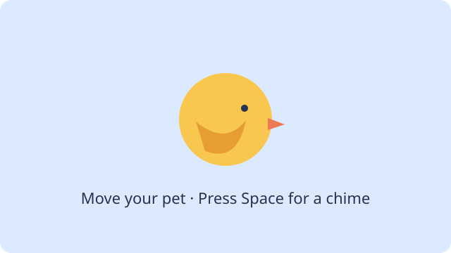

# 8. Give your pet a class



Continue the same Pet project from [lesson 7](16-pet-motion.md). Your bird should move, flap and chime.

## 1. Start a branch for this change

Start from the working **main** checkpoint you committed and synced in
[lesson 7](16-pet-motion.md#18-save-the-working-version). In the **Project**
panel, click the current branch name, **main**, then choose:

**New branch…**

Enter `pet-refactor` and press Enter. Check that Zero shows `pet-refactor` as
the current branch. You are on a new local branch that starts from the same
checkpoint as **main**.

## 2. Try a movement change and discard it

Practise with a clean starting point. Check that **Files** shows no changed
files and that your editors are saved. Finish any other work before trying
this exercise.

In `java/Main.java`, change only the Right arrow line in `update`:

```java-after-2-r1
        if (keyDown(Key.RIGHT)) x += 160 * seconds;
        if (keyDown(Key.RIGHT)) x -= 160 * seconds;
```

Save and choose **Run**. Click the canvas and hold Right. The bird now moves
left. Stop the game. You want to keep the original controls, so discard the
experiment before refactoring.

On Mac, hover over the **Files** heading and choose the **Discard All Changes…**
icon. Check that `Main.java` is the only changed file before confirming
with **Discard Changes**. This returns the files to the last commit and can
remove newly added files.

On Windows, or if the discard icon is unavailable, change the Right arrow
line back to `x += 160 * seconds;` and save.

Choose **Run** again. Right should move the bird right. Stop the game and stay
on `pet-refactor` for the next step.

## 3. Give the pet its own class

`Main` currently handles the pet's position and animation as well as input and sound. A class lets the pet own its position and animation instead.

Create `Pet.java` beside `Main.java` in the `java` folder. Put this complete class in the new file and save it:

```java
import zero.GameApp;
import zero.SpriteAnimation;

// One pet owns its position and animation clock.
public class Pet {
    private final SpriteAnimation animation;
    private double x = 280;

    public Pet(SpriteAnimation animation) { this.animation = animation; }

    public void update(int direction, double seconds, double canvasWidth) {
        x += direction * 160 * seconds;
        x = Math.max(0, Math.min(x, canvasWidth - 80));
        animation.update(seconds);
    }

    public void draw(GameApp game) {
        game.image(animation, x, 150, 80, 64);
    }
}
```

The constructor saves the animation, and `x` holds the pet's position. The `update` method moves and animates the pet; `draw` paints it using the game passed to it.

## 4. Update Main to use your pet

Open `java/Main.java`, select its entire contents and replace them with this complete file. Save it alongside `Pet.java`:

```java
import zero.Color;
import zero.GameApp;
import zero.ImageRegion;
import zero.Key;
import zero.Sound;
import zero.SpriteAnimation;

public class Main extends GameApp {
    private Pet pet;
    private Sound chime;

    @Override public void settings() { size(640, 400); }
    @Override public void setup() {
        var sheet = loadImage("/pet/bird-flap-sheet.png");
        ImageRegion[] frames = {
            imageRegion(sheet, 0, 0, 701, 561),
            imageRegion(sheet, 701, 0, 701, 561),
            imageRegion(sheet, 0, 531, 701, 561),
            imageRegion(sheet, 701, 531, 701, 561)
        };
        pet = new Pet(new SpriteAnimation(8, frames));
        chime = loadSound("/pet/chime.wav");
        chime.setVolume(0.25);
    }

    @Override public void update(double seconds) {
        int direction = 0;
        if (keyDown(Key.LEFT)) direction--;
        if (keyDown(Key.RIGHT)) direction++;
        pet.update(direction, seconds, width());
        if (keyPressed(Key.SPACE)) {
            chime.stop();
            chime.play();
        }
    }

    @Override public void draw() {
        background(Color.rgb(240, 248, 255));
        fill(Color.rgb(47, 79, 79));
        textSize(20);
        text("Click the canvas; arrows move, Space chimes.", 20, 30);
        pet.draw(this);
    }

    public static void main(String[] args) { launch(args); }
}
```

Main creates one pet with `new Pet(new SpriteAnimation(8, frames))`. Each frame, it passes the direction, elapsed time and canvas width to `pet.update` **once**, then calls `pet.draw(this)`. Here `this` is the running game that supplies the drawing methods. Main still handles the keys and sound; holding both arrows gives direction 0.

## 5. Test the refactor

Run the app and click the canvas. Check that the bird still appears and flaps, the arrow keys move it, and Space plays the chime. Hold both arrows together and check that the bird stays in place. The game should behave as it did before the refactor.

If something does not work, compare your files with [Pet.java](../../teaching/checkpoints/13/3/Pet.java) and [Main.java](../../teaching/checkpoints/13/3/Main.java). Explain which data belongs to the pet and why Main no longer needs the animation update details.

## 6. Save the working refactor

Save both files, enter `Extract the Pet class`, and choose **Commit**. This
gives you a working checkpoint on `pet-refactor` before you add the welcome
screen. You will sync the branch in the next lesson.

Keep this project open for [the welcome screen](14-own-project.md). If you
reopen it on **main**, click the current branch name and select
`pet-refactor` from the local branch list.
