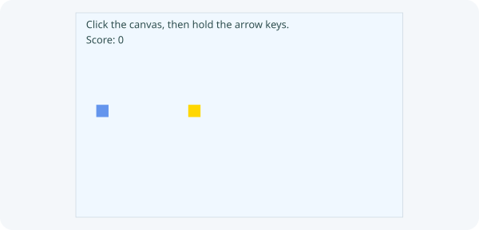

# Coin game revisited: meet Actor



Turn the player and coins into actors while keeping the score, winning and Restart.

Open your existing Coin game project. This lesson needs a project whose
Zero library includes `Actor.touches(Actor)`; an older Coin project may not have
that method yet. Use a project with the matching Actor library before continuing.

This exercise replaces `Main.java`, `Player.java` and `Coin.java` in two
working stages. It keeps movement, three coins, scoring,
winning and Restart, but resets the canvas to 640 × 360 and uses arrow keys and
a plain score label. The earlier `PlayerInput`, `ScoreDisplay`, badge, optional
WASD, artwork, sound and scrolling are not used by this version. Their other
files remain in your project. Your committed original stays on main; after the
exercise, use it as a reference to bring back any features you want.

## 1. Start a branch for this change

Start from a working checkpoint you committed and synced on **main**. In
the **Project** panel, click the current branch name, **main**, then choose:

**New branch…**

Enter `actor-refactor` and press Enter. Check that `actor-refactor` appears as
the current branch before continuing.

## 2. Give Player an Actor

Replace `java/Player.java` with this class. `extends Actor` gives Player a centre,
size, movement and drawing helpers. `super(x, y)` sets its centre; `setSize`
sets its 24 × 24 hitbox. In `draw`, `(0, 0)` is the centre of the actor, so
`(-12, -12)` starts the square at its top-left corner. The `touches` method
lets the existing Coin check contact until you convert it in step 4.

```java
import zero.Actor;
import zero.Color;

public class Player extends Actor {
    public Player(double x, double y) {
        super(x, y);
        setSize(24, 24);
    }

    public void steer(int horizontal, int vertical, double seconds) {
        move(horizontal * 180 * seconds, vertical * 180 * seconds);
        setPosition(Math.max(12, Math.min(x(), 628)), Math.max(12, Math.min(y(), 348)));
    }

    public boolean touches(double coinX, double coinY, double coinSize) {
        return x() + 12 >= coinX && x() - 12 <= coinX + coinSize
                && y() + 12 >= coinY && y() - 12 <= coinY + coinSize;
    }

    @Override public void draw() {
        fill(Color.rgb(100, 149, 237));
        rect(-12, -12, 24, 24);
    }
}
```

## 3. Run the game with an Actor player

Replace `java/Main.java` with this version. Keep your existing `Coin.java`
for this checkpoint. Main calls the player's `steer`, `update` and drawing
methods while the coins still use their existing contact and drawing code.

```java
import zero.Color;
import zero.GameApp;
import zero.Key;
import zero.ui.Button;
import zero.ui.Label;
import zero.ui.Row;

public class Main extends GameApp {
    private Player player;
    private Coin[] coins;
    private int points;
    private boolean won;
    private Label scoreLabel;
    private Label message;

    @Override public void settings() { size(640, 360); }

    @Override public void setup() {
        scoreLabel = new Label("");
        message = new Label("");
        Button restartButton = new Button("Restart");
        restartButton.onClick(() -> restart());
        controls(new Row(12, scoreLabel, message, restartButton));
        restart();
    }

    public void restart() {
        player = new Player(52, 192);
        coins = new Coin[] { new Coin(220, 180), new Coin(420, 80), new Coin(540, 300) };
        points = 0;
        won = false;
        scoreLabel.setText("Score: 0");
        message.setText("Collect all " + coins.length + " coins.");
        showGame();
    }

    @Override public void update(double seconds) {
        if (won) return;
        int horizontal = (keyDown(Key.RIGHT) ? 1 : 0) - (keyDown(Key.LEFT) ? 1 : 0);
        int vertical = (keyDown(Key.DOWN) ? 1 : 0) - (keyDown(Key.UP) ? 1 : 0);
        player.steer(horizontal, vertical, seconds);
        player.update(seconds);
        for (Coin coin : coins) {
            if (!coin.isCollected() && coin.touches(player)) {
                coin.collect();
                points++;
                scoreLabel.setText("Score: " + points);
            }
        }
        if (points == coins.length) {
            won = true;
            message.setText("You win! Choose Restart.");
        }
    }

    @Override public void draw() {
        background(Color.WHITE);
        for (Coin coin : coins) coin.draw(this);
        draw(player);
    }

    public static void main(String[] args) { launch(args); }
}
```

Choose **Run**, click the canvas and use the arrow keys. Check that the blue
square stays inside the canvas. Collect a coin, stay there to check it only
scores once, then collect the other two and try Restart.

Save your files on `actor-refactor`, enter `Convert Player to an Actor`, and choose:

**Commit**

## 4. Give Coin an Actor

Replace `java/Coin.java` with this class. Each coin has its own centre, size and
collection state. A collected coin stops drawing.

```java
import zero.Actor;
import zero.Color;

public class Coin extends Actor {
    private boolean collected;

    public Coin(double x, double y) {
        super(x, y);
        setSize(24, 24);
    }

    public boolean isCollected() { return collected; }
    public void collect() { collected = true; }

    @Override public void draw() {
        if (!collected) {
            fill(Color.GOLD);
            rect(-12, -12, 24, 24);
        }
    }
}
```

In `Main.java`, add 12 pixels to each starting coordinate to place the
centres of the coins where their squares were before. In `restart()`, replace
the coins line with the copied code:

```java-after-2-r1
        coins = new Coin[] { new Coin(220, 180), new Coin(420, 80), new Coin(540, 300) };
        coins = new Coin[] { new Coin(232, 192), new Coin(432, 92), new Coin(552, 312) };
```

In the `update()` loop, update each coin once and use Actor's contact check.
Replace the matching lines with the copied code:

```java-after-3-4-r2
        for (Coin coin : coins) {
            if (!coin.isCollected() && coin.touches(player)) {
            coin.update(seconds);
            if (!coin.isCollected() && player.touches(coin)) {
```

`player.touches(coin)` checks the actors' size rectangles, including touching
edges. It uses the same rectangles if an actor draws a circle or rotates.
Main still collects the coin and updates the score.

In `draw()`, replace the coin drawing line with the copied code:

```java-after-2-r1
        for (Coin coin : coins) coin.draw(this);
        for (Coin coin : coins) draw(coin);
```

In `Player.java`, remove the temporary method
`touches(double coinX, double coinY, double coinSize)`, including its body.

Run and check that coins disappear, score once and return on Restart.
Collect all three to check the win message. Save your files, enter
`Convert Coin to an Actor`, and choose:

**Commit**

## 5. Sync, merge and test on main

Stop the game. With `actor-refactor` selected, choose:

**Sync**

Wait for Sync to finish. Choose **Merge** beside the branch name and confirm
**Merge actor-refactor into main?**

Confirm **main** is selected. Run the merged game and test movement, scoring,
winning and Restart.

## 6. Publish the tested game

Stop the game and open the Run dropdown, then choose:

**Publish & open app**

Play the published game and try Restart.
