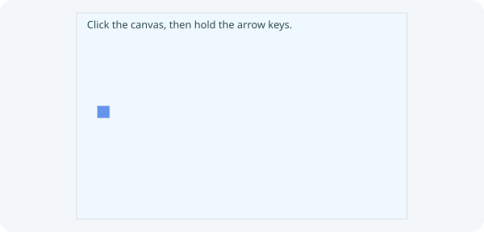

# 14. Build and publish your own game

## 1. Create your project

Sign in and connect GitHub in Zero. On the Start Page, choose:

**Project → New**

Name your game (for example, `zero-signal-rescue`). Choose a clone location.
Zero creates your own public repository. Share only code and assets you have
permission to publish, and follow your school’s sharing rules.

## 2. Pick one goal and start a branch

Choose what the player does and how they win. For example, guide a rescue
bot to a beacon by way of a charging station. Run the starter on **main**,
then stop it. Click **main** in the **Project** panel and choose:

**New branch…**

Name it `first-playable` and check that it is selected.

## 3. Make the game respond

For a fresh start, follow steps 2–6 of [Move a player](08-movement.md) in
your new project. You can also bring over a helper you wrote, such as
`Player.java`, and connect it to your new `Main.java`. Keep the tutorial
repository for the tutorial, and bring over only the files your game uses.

Choose **Run** and try the controls. When they work, stop the game, save and
choose **Commit** with a message such as `Add player controls`.

## 4. Add your own rule and test it

Give the player a goal that changes how they play. For the rescue bot, the
beacon only works after the bot visits the charger. Use a boolean to remember
that visit. For contact checks, see steps 1–2 of
[Build a coin game](09-coin-game.md). Use steps 10–15 to wire a Restart button
to your own `restart()` method. Reset the player's position, the charger visit
and the win state there.

Run and try reaching the goal too early, winning, and starting over. Stop
the game, save and choose **Commit** with a message describing your rule.

## 5. Sync, merge and test on main

On `first-playable`, choose **Sync**. When it finishes, choose **Merge**
and confirm the merge into **main**. Run the merged game on **main** and
check the controls, win rule and Restart.

## 6. Publish and play in the browser

Stop the game. Open the Run menu and choose:

**Publish & open app**

Review the publishing prompts. When the game opens, try to win and restart.
Keep the GitHub Pages link so you can share it directly.

## 7. Check your listing

Open [ZeroHub → Projects → My Projects](https://zero.codepet.ca/hub/listings) and sign in with
the account you used to publish. Find your game. Eligible games can appear
on ZeroHub after publishing. If yours is under **Apps not on ZeroHub**,
check your listing slots before choosing **Add to ZeroHub**. If the game
is missing, check [how app listings work](https://zero.codepet.ca/hub/listings?view=help).

## 8. Play from ZeroHub

Open [Browse projects](https://zero.codepet.ca/hub?kind=game). Search for your game by its name and
check the GitHub username on the card. Click its **Play** tile and try your
win rule again. The tile opens the same published game.
